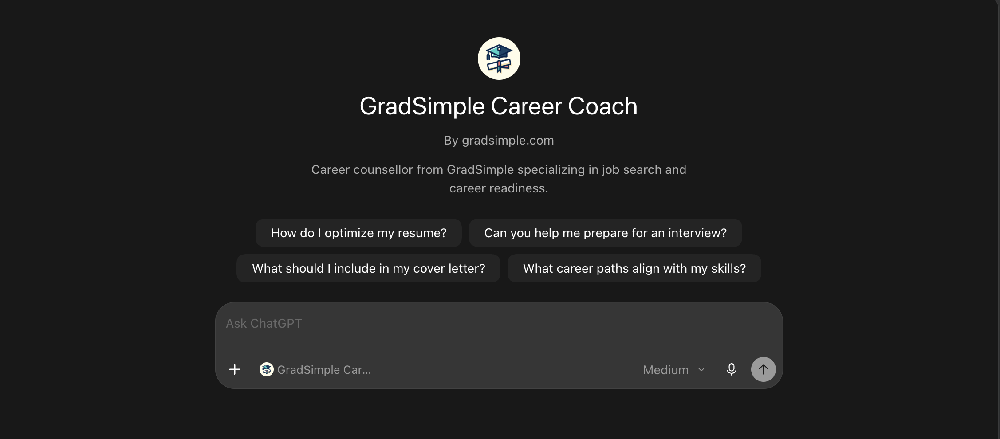

# Tyler Yip: Projects

### GradSimple

Career stories and practical tools for figuring out what comes next, including how to use AI at work.

I run GradSimple for people figuring out their next career move. I interview people about the work they do, how they got there, and the decisions they made along the way. I like getting past the job title and hearing the actual story.

Those conversations become interviews and newsletters, alongside tools for exploring careers and pay. These days, I’m also digging into how AI is changing the work itself, and how readers can use it for themselves.

Outcomes:

- 7,259 newsletter subscribers
- 43,860 annual active website users, up 102% year over year
- Sponsored by Lovable, HubSpot, Webflow, Morning Brew, and 1440.

#### Search & AI visibility (2026 YTD)

- 1M+ Google Search impressions
- 134.8K Bing search impressions
- 66K citations across Microsoft Copilot and partners

These visibility figures cover January 1 to November 5, 2026. Google’s 1M+ is rounded from 1,003,957 impressions. Search impressions, Microsoft AI citations, and active users are different measures and are not added together as unique reach.

The annual active-user figure comes from GA4, November 2025 to October 2026, with growth compared to the preceding twelve months. It covers all measured traffic sources. The 7,259-subscriber figure matches the archived site screenshot and is not a live counter.

#### Related tools

- [Career Explorer](https://career-explorer-ecru.vercel.app/): O*NET’s career data, with an interface that feels a little less early 2000s.
- [Starting Pay Checker](https://starting-pay-checker.vercel.app/): An easier way to find and compare pay, especially when starting out.
- [Job Market Radar](https://job-market-radar.vercel.app/): Monthly BLS hiring data, made easier to explore and compare across industries.
- [How Cooked Is Your Career?](https://career-cooked-check.base44.app/): A seven-question career check-in with a “cooked score.” An early Base44 experiment.
- [Career Intelligence Report](https://career-intelligence-report.vercel.app/): An early Claude-powered prototype for personalized career reports, from a target role to a 90-day plan.

#### Career Intelligence MCP

I also built a Career Intelligence MCP so those stories and data could be useful inside an AI conversation. It lets an assistant search GradSimple’s public interviews, guides, and statistics, then link back to the sources. I wanted people to be able to ask a question and explore the relevant material without digging through the whole site themselves.

#### Career Coach GPT

One of my earliest AI experiments was a custom Career Coach GPT for resume feedback, interview prep, and figuring out possible career paths.

#### Reddit research & drafting

Finding relevant Reddit posts and writing replies used to take me two to three hours a day. AI-assisted drafting got that down to about half an hour, but I was still finding the posts myself.

Then I used Codex to handle post discovery and drafting too. It could open relevant posts and prepare replies for me to review. Much less repetitive clicking and typing. My fingers were very grateful haha.

The later automation ran well for about three months and helped grow GradSimple’s subscriber list. My account was banned in August, which brought the experiment to an end.

[View Reddit Scout on GitHub](https://github.com/tyleroars/reddit-scout)

[Visit the site](https://gradsimple.com)

[Project story on Tyler’s site](projects.html#gradsimple)

### HuddleDex

An iPhone app for remembering the people, conversations, and promises from an event. Built the day before, then used there!

I was going to Knak’s Agentic Marketing Forum and had an idea the day before. At events, you meet people, have a good conversation, maybe connect on LinkedIn. But afterward, how much do you actually remember? Their name, what you talked about, that thing you said you’d send them?

I wanted a way to save that context while it was fresh. Scan someone’s badge for their details, take a photo of them or a selfie together, and record a quick voice note instead of typing everything out. The app could transcribe it and keep the conversation, photo, and follow-up attached to the person and event.

They could also scan my QR to get my digital card and save my contact, and I could share our photo so we both had a record of meeting. They wouldn’t need to download the app for that. So I vibecoded HuddleDex, got it onto my iPhone, and took it with me the next day.

I also found things I’d missed pretty quickly. Someone asked for my phone number, but my digital card didn’t have it. I went to add it and realized I hadn’t even built a phone-number field. So I couldn’t update it lol.

Outcomes:

- Built the day before the event and used it at Knak’s Agentic Marketing Forum
- Attendees scanned my QR to save my digital business card

[Try browser prototype](huddledex-browser/)

[Browser build prompt](build-prompts/huddledex-browser.txt)

[Download the browser starter source](build-prompts/huddledex-browser-starter.zip)

The original app lives on my iPhone. Here’s a browser starter you can build on!

[Project story on Tyler’s site](projects.html#huddledex)

### AI Worth Trying

Ready-made AI prompts, skills, and workflows for marketers figuring out what to use AI for.

AI Worth Trying grew out of my day job at Knak. I work with marketing operations people every day, and lots of them are being asked to use AI without much help on what to use it for.

I wanted to give them a starting point. The library is a mix of my own experience, recommendations, and useful prompts and workflows I’ve found other people sharing online.

Pick a marketing task and you’ll find something to try, with the context to provide and the output to aim for. There are ready-made prompts, skills, and workflows, plus buttons to copy a prompt or open it in an AI tool.

Outcomes:

- 801 published marketing prompts across 12 marketing categories

[Visit the site](https://aiworthtrying.com)

[Project story on Tyler’s site](projects.html#aiwt)

### Tone Lab

A simple photo editor for occasional tweaks, inspired by Fujifilm. No subscription!

I shoot Fujifilm and usually let the camera recipes do the work. I don’t edit very often, so paying for Lightroom or a feature-heavy editor felt like overkill.

But I still wanted to make simple adjustments now and then. My needs were pretty modest, so I decided to build an editor around the looks and controls I wanted!

I’ve used Tone Lab on my own photos to tweak the light and colour, try different looks, compare versions, and export the ones I like. It runs in the browser, with the photos staying on my device. No extra editing subscription for something I only use occasionally.

[Try the tool](https://tonelab-darkroom.thetyleryip.chatgpt.site)

[Project story on Tyler’s site](projects.html#tone)

### Vibe Coding Hackathon Vancouver (Sponsored by Codex)

A career-path visualizer that turns a résumé and four questions into three possible routes. Built with a team in six hours!

GradSimple subscribers often told me they struggled to picture different career paths. Having lots of options wasn’t much help if you couldn’t see what any of them might look like. I wanted to make those possibilities easier to explore.

I took that idea to my first AI vibe coding hackathon in Vancouver. I arrived without a team or a coding background, teamed up with three people I met that morning, and we had about six hours to build something!

We made a visualizer that took a résumé and answers to four questions, then mapped out three possible routes. It drew on O*NET salary and job data and GradSimple career profiles. I worked on the product, interface, and presentation with Codex, while my teammates helped work through the technical choices.

Our live demo was shaky, and we didn’t win, but we got special recognition for UI/UX and product. One of the judges even told me afterward that it was his number-one pick! We didn’t release it publicly because the API costs and reliability still needed work.

Outcomes:

- Built a working career-path demo with my team in about six hours
- Received special recognition for UI/UX and product

[Read my hackathon story, part one](writing/i-did-my-first-ai-hackathon-part-1.html)

[Read part two](writing/i-did-my-first-ai-hackathon-part-2.html)

[Project story on Tyler’s site](projects.html#hackathon)

### Career Explorer

O*NET’s career data, with an interface that feels a little less early 2000s.

O*NET has so much useful career data, but I hated the UI/UX. It feels like it hasn’t been updated since the early 2000s!

I wanted a version GradSimple readers could explore without wrestling with the interface. Career Explorer lets you search for roles, filter by education, pay, and field, then open an occupation to see its description and outlook.

The first version took me about two hours with Claude. I deployed it and embedded it in GradSimple so readers could try it themselves.

[Try the tool](https://career-explorer-ecru.vercel.app/)

[Project story on Tyler’s site](projects.html#career)

### Starting Pay Checker

An easier way to find and compare pay, especially when starting out.

I built this for GradSimple subscribers who wanted to know what different jobs might pay when they were starting out. That’s surprisingly hard to find online! A headline salary doesn’t always tell you much about the lower end of the range.

Starting Pay Checker turns BLS wage data into a searchable list of roles. You can filter by field and compare the lower end of each occupation’s pay range as a reference for starting out.

[Try the tool](https://starting-pay-checker.vercel.app/)

[Public source code](https://github.com/tyleroars/starting-pay-checker)

[Project story on Tyler’s site](projects.html#pay)

### Job Market Radar

Monthly BLS hiring data, made easier to explore and compare across industries.

BLS has lots of useful hiring data, but it’s hard to digest. I couldn’t find a clear way to see the trends together that made sense for GradSimple’s audience, so I built Job Market Radar.

The industry cards bring openings, hires, and year-over-year changes into one view. Open a card for a 24-month chart, switch between openings, hires, and quits rate, or sort industries to see where things are growing or slowing down.

I share it in the GradSimple newsletter so subscribers can explore the trends themselves. The reporting month stays visible, so they can see which data they’re looking at.

[Try the tool](https://job-market-radar.vercel.app/)

[Project story on Tyler’s site](projects.html#radar)

### Image Optimizer

A browser image resizer and compressor, built after too many free-app limits. No ads!

I kept running into limits with free image apps, so I decided to build my own. I wanted to get images ready for email without hitting another limit or wading through ads.

Drop in an image, choose the size and compression settings, and download the result. It also handles format conversion and animated GIFs. Everything runs in the browser, so the images stay on your device.

[Try the tool](https://gradsimple-image-optimizer.netlify.app/)

[Project story on Tyler’s site](projects.html#image)

### Slides → Video

Turn existing TikTok slides into a video ready for YouTube.

Grace and I wanted to reuse our TikTok slides on YouTube, which meant turning them into a video. We couldn’t find a tool that fit our workflow, and assembling each video manually would have been a pain.

So I built this for Grace. She can upload her existing slides, choose how long each one stays on screen, and export a video ready for YouTube. The tool handles the video assembly for her.

It accepts individual images or a ZIP, lets you drag slides into order, and runs in the browser. MP4 export depends on browser support, with WebM as a fallback.

Outcomes:

- 10 demo slides exported as a 30-second MP4 in under a minute, with the slides already loaded

[Try the converter](https://glowing-cajeta-86ab7f.netlify.app/)

[Project story on Tyler’s site](projects.html#slides-converter)

### Newsletter Converter

A way to turn Kit newsletters into WordPress articles when the archive options weren’t cutting it.

Kit didn’t give me an easy way to display archived newsletters the way I wanted. I wanted those issues on the GradSimple website, so I built a converter to bring them into WordPress.

The workflow was to paste in the newsletter HTML, convert it, then check the article preview. The tool cleaned up email footers and layout markup and gave me HTML I could copy into WordPress. I’d check the content and embeds before publishing.

I don’t use it anymore.

[Try the tool](https://tyleroars.github.io/my-tools/jm5-converter.html)

[Public source code](https://github.com/tyleroars/my-tools)

[Project story on Tyler’s site](projects.html#newsletter)

### Career Intelligence Report

An early Claude-powered prototype for personalized career reports, from a target role to a 90-day plan.

I wanted to try giving GradSimple Insiders a career report built around their own situation. A target job title alone leaves a lot out, so the form also asked about their background, experience, and location.

This was my first time connecting an app to the Claude API! The app sent that context and an optional résumé to Claude. The report covered how realistic the move was, skills to work on, AI’s effect on the role, and a 90-day plan.

The screenshots are from an original management consulting report I saved. This stayed an early prototype; it isn’t a live report service.

[View the prototype](https://career-intelligence-report.vercel.app/)

An early prototype, not a live app. The report excerpts are from an original March 2026 export.

[Project story on Tyler’s site](projects.html#career-report)

### The Frenz

A Discord community and a planned NFT collection, with artwork by Hozer in Korea. The collection never launched.

I co-founded The Frenz in 2021, a Discord community with plans for an NFT collection. My part was research, financials, and partnerships, as the team’s head analyst.

We worked on the collection with Hozer, an artist based in Korea. A mutual friend from college who was active in Web3 introduced us! We collaborated on the characters while the team developed the lore, community activities, Discord mechanics, and launch plans.

The community reached around 1,500 members at its peak. After the NFT market shifted, we chose not to launch the collection.

Outcomes:

- Around 1,500 Discord members at its peak

[Project story on Tyler’s site](projects.html#the-frenz)

### How Cooked Is Your Career?

A seven-question career check-in with a “cooked score.” An early Base44 experiment.

I wanted to try a lighter way to get someone thinking about their career. So I built a seven-question check-in that gives you a “cookedness” score out of 100. This was one of my early Base44 experiments!

It asks about Sunday-night dread, whether you use your skills at work, and how you feel about your future. Answer all seven and it gives you a result to reflect on. The link goes to the original Base44 build.

[Try the quiz](https://career-cooked-check.base44.app/)

[Project story on Tyler’s site](projects.html#career-quiz)

### Kawaii Peach

An online store started after two cancelled internships, selling apparel and accessories.

Grace and I both lost our internships when the pandemic hit in 2020. Neither of us knew ecommerce, but we decided to start an online store anyway! We ran Kawaii Peach from March 2020 to March 2021, figuring out products, pricing, the storefront, and customer service as we went.

A lot of the work was getting people to find us. We planned the Instagram feed, worked on the content, ran ads, and tracked how posts and stories performed. Our social content had a 7% engagement rate!

We also worked on SEO, getting pages onto the first page of Google.

We both ended up using the experience to help land our first jobs.

Outcomes:

- Over $30,000 in sales
- Nearly 10,000 followers across Instagram and Facebook within three months
- Top 1% for traffic among Shopify stores launched in the same month

[View the 2020 Wayback Machine snapshot](https://web.archive.org/web/20201125200531/https://kawaiipeach.com/)

[Project story on Tyler’s site](projects.html#kawaii-peach)
