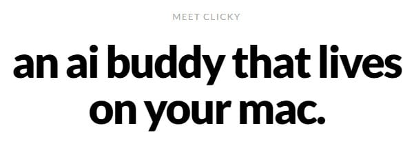
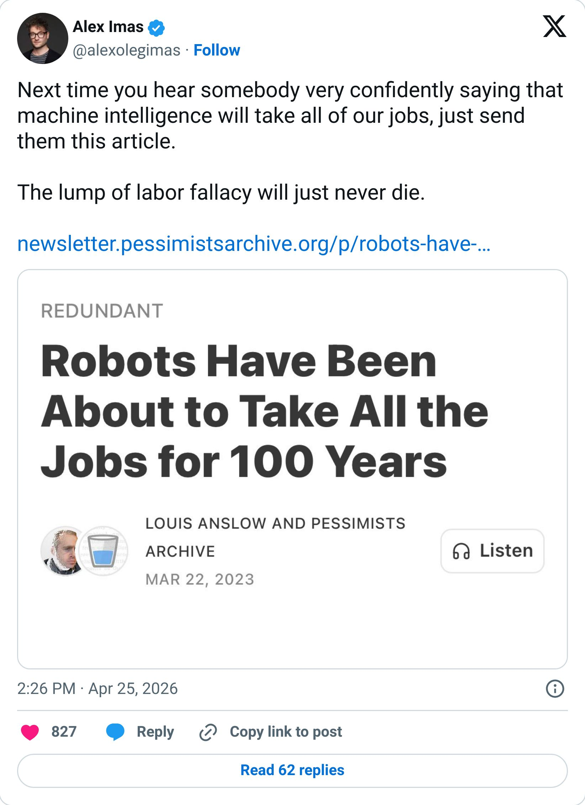

# An AI buddy that lives on your mac?

By Tyler Yip · 2026-04-30

And... WTF is an MCP?

I’ve been feeling burnt out. Ironic, considering I’m starting a new project (this newsletter) this week. My brain has been going at 150 miles an hour, non-stop, thinking about my 9 to 5 AND [GradSimple](https://gradsimple.com/).

AI Worth Trying will, hopefully, be the little project that breaks my routine. A welcome distraction, if you will.

## WTF is… “MCP”

You've probably seen "MCP" pop up on LinkedIn or at work and wondered what the heck everyone is talking about.

**MCP stands for Model Context Protocol.** Think of it like a universal plug for AI.

Right now, if you want an AI tool to connect to your Google Calendar, your Slack, or your company database, someone has to build a custom connection from scratch. It's slow and expensive.

MCP is a shared standard that makes those connections easier to build. Instead of every AI tool having to reinvent the wheel, MCP gives developers one common way to plug AI into... basically anything.

**A simple analogy:** Remember when USB replaced all those different charger cables? MCP is trying to do that for AI integrations.

It was created by Anthropic (the company behind Claude), but they released it as an open standard, meaning any company can build on it. And a lot of them are. OpenAI, Google, and dozens of other tools have started supporting it. It's not the only standard out there, but it's quickly becoming one of the most widely adopted.

**Why should you care?** Because AI is moving from "chatbot you talk to" toward "assistant that actually does things inside your tools." MCP is a big part of what makes that possible.

In just the past few months, OpenAI, Google, and hundreds of other companies have added MCP support. Developer adoption has exploded. When competing companies start rallying around the same standard, that's usually a sign something is sticking.

If MCP becomes the default way AI connects to software, the tools that support it will be a lot more powerful than the ones that don't. So even if you're not building anything, knowing what MCP is puts you ahead of most non-techies in the room.

## AI spotlight: [Clicky](https://www.heyclicky.com/)

**What is it?** Clicky is an AI that lives next to your cursor on your Mac. It sees everything on your screen, so you can ask it questions out loud about whatever you're working on. You can also tell it to go do things for you in the background, like research, building something, or summarizing a doc.

**My initial thoughts: **This would save my hands from carpal tunnel. I don’t know about you, but having to type out context to ChatGPT is the bane of my existence. It’d be a dream to be able to talk to AI like a person and “co-work” live, since it can already see my screen. Going on my list to try.

## Caught my eye on X

> 

[Read on Tyler’s site](an-ai-buddy-that-lives-on-your-mac.html)
