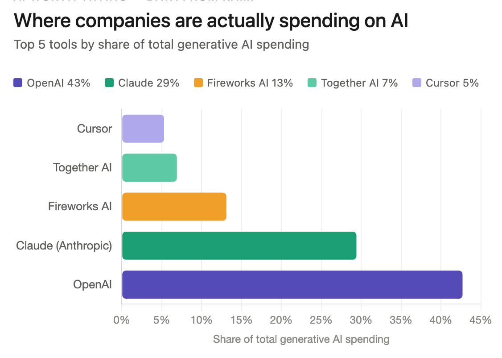
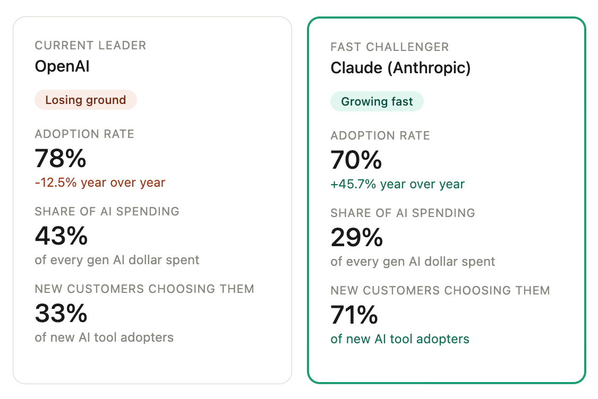
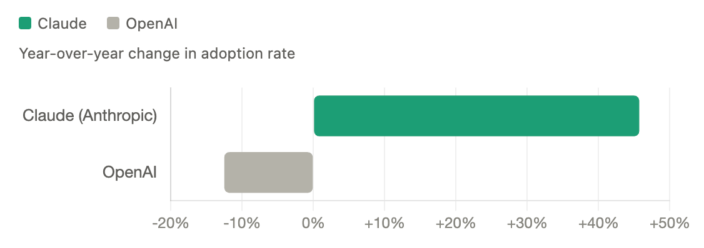

# Claude is eating OpenAI's lunch

By Tyler Yip · 2026-05-13

I know, I'm supposed to be an OpenAI fan. But the data doesn't lie.

Look, I love ChatGPT. Use it every single day. It's basically my college sweetheart of the AI world. Heck, I'm literally their Customer Success Manager at Knak. So believe me, I am rooting for them to win.

But the numbers don't lie.

## This week I tried… using Ramp’s Data connector to snoop on how companies are spending their money

Last week, Anthropic added Ramp's data as a connector in Claude. Ramp is a corporate card and spend management platform used by 50,000+ businesses. And now you can ask Claude what their customers are actually spending on, for free. This is a really big deal, at least to a data nerd like me.

I was particularly curious about one thing: which AI tools are companies burning the most money on? So I looked it up. Here's what I found.

Honestly, the results were not what I expected. For one, Gemini is missing. It is one of the most widely used AI tools in the world, yet it's completely absent. Same goes for Midjourney, Microsoft Copilot, and Notion AI.

My best guess is that the dataset only captures tools people are swiping a card for every month. Gemini comes with Google Workspace. Copilot comes with Microsoft 365. Those are usually big annual contracts paid through invoicing, not a corporate card. So they just don't show up here

I also hadn't heard of Together AI or Fireworks AI before this. Turns out they're developer infrastructure tools where companies spend millions on API calls a month. So while this isn't a complete picture of every business in the world, it's very relevant if you work in tech.

I wanted to dig deeper so I asked Claude to compare OpenAI and Claude directly on spend and adoption. And wow.

Source: Ramp spend data, generative AI category. Adoption rate = share of Ramp customers with at least one transaction with this vendor.

I knew Claude had been catching up to ChatGPT, but I didn't know it was happening this fast! Claude is still #2 on spending but is growing at a whopping 45.7% year over year and winning 71% of new customers.

At this rate, I wouldn't be surprised if Claude flips ChatGPT within the next year or two.

**Now go try it yourself. Here’s how:**

- Open Claude and click **Customize** in the sidebar

- Click **Connect your apps**

- Search for and connect the **Ramp Data** connector

- Open a new chat, and ask Claude anything about company spending. Just mention Ramp in your prompt so it knows where to pull from. Something like: `Using Ramp data, what are companies in the tech industry spending the most on?`

[Read on Tyler’s site](claude-is-eating-openai-s-lunch.html)
