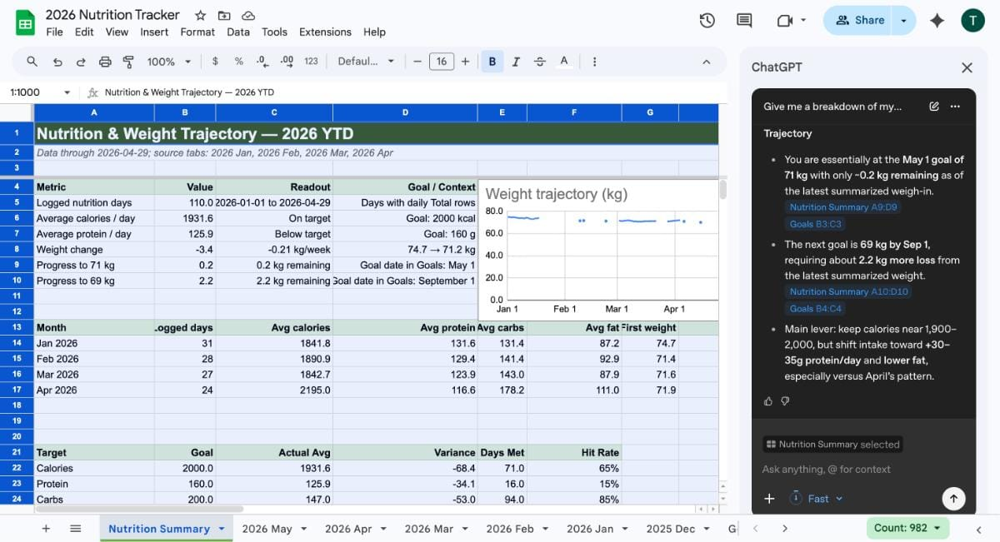

# Fine, I'll stop cheating on you, ChatGPT

By Tyler Yip · 2026-05-07

OpenAI's latest Google Sheets add-on has me feeling things.

I've been cheating on ChatGPT with Claude since February. But ChatGPT keeps releasing things that make me feel guilty about it. This week it was a Google Sheets add-on. And as a guy who got a finance degree just to never use Excel again, I had a lot of feelings about it.

## This week I tried… using ChatGPT’s latest Google Sheets add-on

Boy am I glad I didn't pursue investment banking. At the junior level, you're basically an Excel monkey. The average finance bro probably spends 8 hours a day wrangling data and building financial models.

My worst nightmare. For those who don't know, I graduated with a finance degree and specialized in financial engineering and risk management (why I did that to myself, I still can't tell you). I had courses that revolved entirely around how to use Excel. News flash, I don't work in finance.

I literally pivoted careers to get away from Excel. So when I heard ChatGPT built a [Google Sheets add-on](https://chatgpt.com/apps/spreadsheets/) that lets you build, edit, and analyze spreadsheets by just telling it what you want, I couldn't be more excited. If I was a finance bro, this would send me into an existential crisis.

I decided to try it out on my personal nutrition tracker. I gave it this prompt:

`Give me a summary of my nutrition and weight trajectory in 2026 YTD.`

It pulled together a full summary with trends, targets, and context I would have spent hours trying to make sense of manually. Within a minute, I learned that I’ve averaged 1,931 calories a day and have been losing 0.46 pounds a week since the start of 2026 (I’m on a diet).

I still remember how painful it was to learn Excel formulas like VLOOKUP. Now, you don’t need any of that to get meaningful insights out of a spreadhseet. What a time to be alive.

I can already think of so many ways to use this. Cleaning up messy data, building a budget tracker, analyzing a social growth dashboard. I'll keep testing and report back.

**Now go try it yourself. Here’s how: **

- [Install ChatGPT for Google Sheets add-on here](https://chatgpt.com/apps/spreadsheets/)

- Open Google Sheets and got to Extensions —> ChatGPT —> Open Sidebar

- Log into your ChatGPT account and you’re good to go!

[Read on Tyler’s site](fine-i-ll-stop-cheating-on-you-chatgpt.html)
