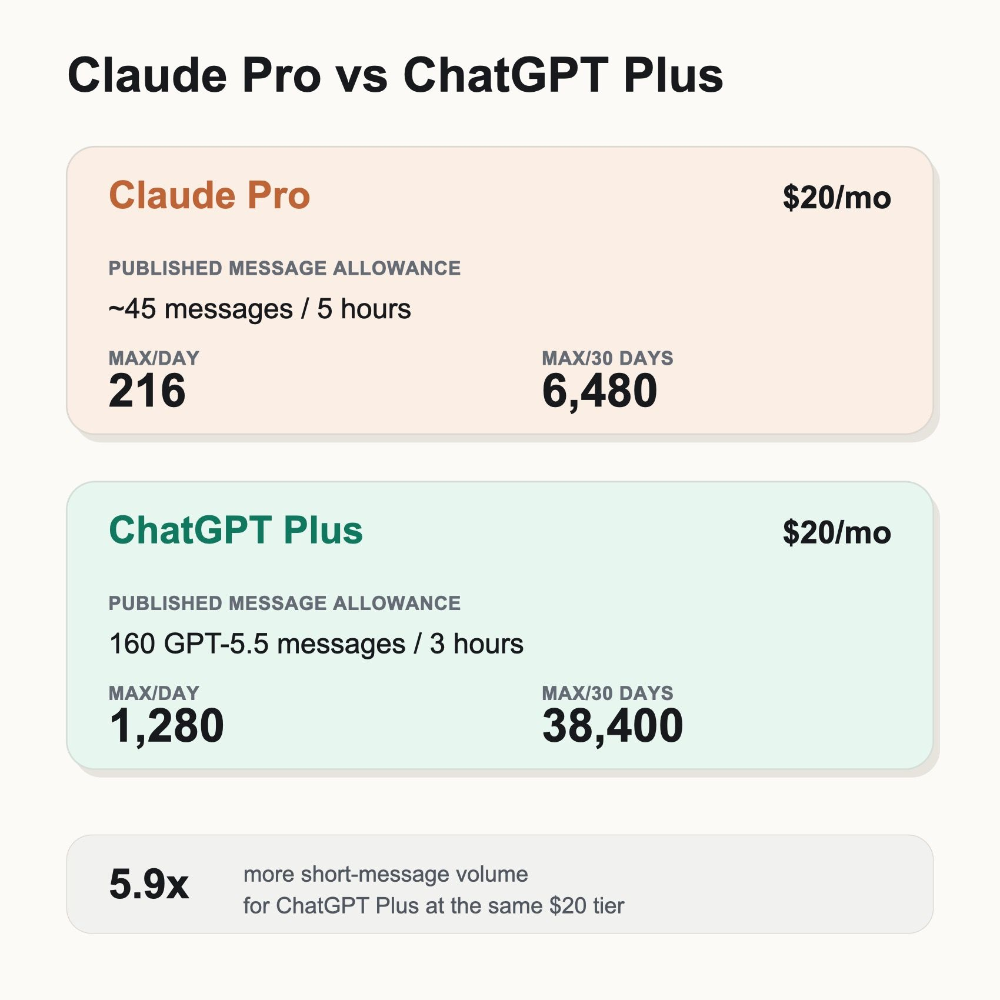

# GPT-Live is Siri on steroids

By Tyler Yip · 2026-07-09

Tinder for humans to meet AI might actually be viable.

AI is having its *Her *moment.

*Her* is a sci-fi romance about a lonely writer who falls in love with an AI operating system named Samantha. One of my favourite movies btw, 10/10 recommend.

OpenAI is rolling out GPT-Live as of July 8, their newest real-time voice model. If you’ve never used ChatGPT’s voice mode before, just think of it like Apple’s Siri.

GPT-Live is like Siri on steroids. It can listen while you talk, respond in real time, handle pauses more naturally, and avoid that awkward voice assistant thing where it interrupts you the second you breathe wrong.

Check out the feature release video:

Insane, right?

With how good GPT-Live looks, it’s only a matter of time humans become emotionally attached to AI en masse.

I don't really use ChatGPT or Claude's real-time voice features yet. Even before AI, I never got comfortable with Siri or Alexa. Mainly due to reliability.

But GPT-Live might change that.

If it works as advertised, I can already imagine using it while traveling, learning, brainstorming, or building apps. I'm especially curious to test it on my Japan trip in October.

Random thought: maybe Tinder for humans x AI could be a good business idea in a few years.

## This week I’m trying… ChatGPT 5.6

ChatGPT 5.6, aka “Sol” is releasing today for everyone.

Early tests show that it can go toe to toe with Fable, Anthropic’s most powerful model. And using just 1/3 of the output tokens.

*If *this is true and not just marketing hype, I think it will propel OpenAI ahead of Anthropic in the AI arms race.

My biggest gripe with Claude is cost.

I love Claude, but for the same price, you get way less usage compared to ChatGPT/Codex.

With Claude, I usually hit my limit multiple times a week. And that’s with me intentionally using Claude less, and avoiding the really token-heavy stuff.

For light users, that probably doesn't matter much.

But if you use AI like a co-worker, builder, research assistant, and personal operating system, the difference becomes painfully obvious.

Even the best model in the world is useless if you can't afford to use it daily.

And don’t even get me started on Fable.

Fable makes absolutely no financial sense for anybody to use. It uses **2x** the tokens of Opus 4.8, and I already use Sonnet over Opus for everyday tasks to conserve my usage.

True story: I tried using Fable to architect an app idea. I hit my Claude limit in 4 prompts.

With Codex, I got it to architect the app and build the whole freaking working app on my phone, and I didn’t even get close to my 5-hour limit.

So yeah, maybe this is turning into a rant.

I’m not alone in feeling this way. Claude is so costly, even gigantic companies like Microsoft are cancelling their Claude Code plans. If even the world’s most valuable companies can’t afford Claude, who on earth can? Serious question.

That’s exactly why Sol could be a game changer.

You’re telling me there might be a model that can compete with Fable, but regular people can actually afford to use it?

Sign me up!

[Read on Tyler’s site](gpt-live-is-siri-on-steroids.html)
