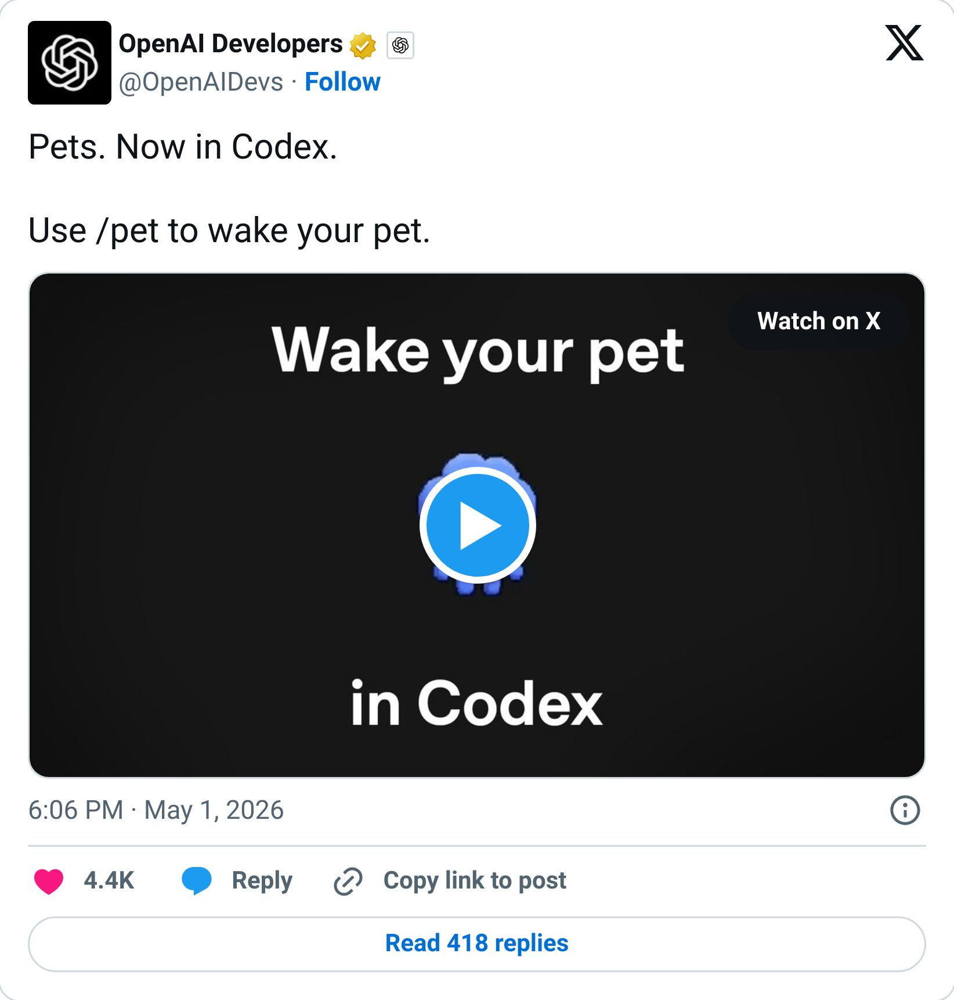
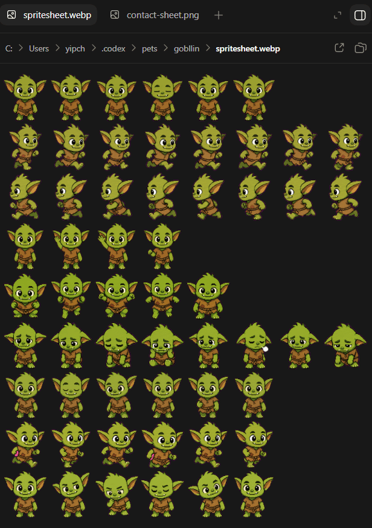

# I am now the proud dad of a goblin

By Tyler Yip · 2026-05-01

I'll show you how you can be a parent too.

I'm still figuring out how to format this newsletter, so bear with me. Expect *a lot *of experiments with structure and layout over the coming weeks.

I know I'm writing into the void right now. But I like to think of it as building a binge bank. At least that’s what I tell myself.

## This week I tried… creating my own pet on Codex

Look, I’m not technical in the slightest. But you’re telling me I can have my very own digital pet??? Sign me up. I will literally do anything.

Today, Codex dropped a new thing where you can create your own pet.

> 

Quick note if you don't know Codex, it's OpenAI's coding tool. I don't really use it. Or I didn't, until pets entered the picture.

I typed in `/pet` and nothing happened. So I had to install something first (more on that below). Once I got it working, I tried creating a custom pet by typing `$hatch-pet Create a little goblin` except I spelled it "gobllin." Two L's. Codex didn't correct me. It actually complimented me for being quirky (of course it did, lol).

Here’s Gobllin, if you’re curious :)

I don't fully know what the pet does yet. I'm not sure it does much. But here's the thing, it made me open Codex three times today. A coding tool I have no business using. OpenAI put a pet in it and I was suddenly very interested. That's kind of genius and I'm not even mad.

**Now go make your own. Here’s how:**

- Type `/pet` in Codex

- If nothing happens, install the hatch skill by typing `$skill-installer hatch-pet`

- Restart Codex

- Type `$hatch-pet` followed by whatever pet you want to create. For example  `$hatch-pet Create a little goblin`

[Read on Tyler’s site](i-am-now-the-proud-dad-of-a-goblin.html)
