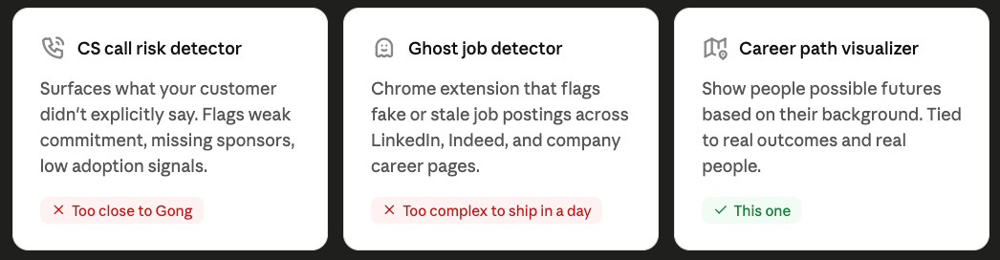
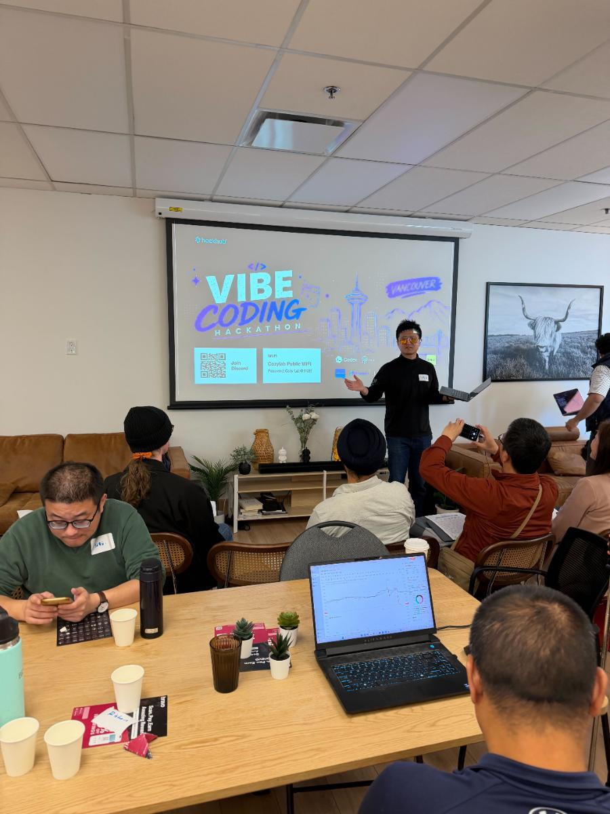

# I did my first AI Hackathon (Part 1)

By Tyler Yip · 2026-06-04

I was one of 3 who couldn't code.

I did my first vibe coding hackathon last week. And somehow led a team while doing it.

If you've never heard of a hackathon before, it's basically a timed competition where people build something from scratch. In the past it was strictly for developers. But with AI? Anyone can build anything now.

Even me.

## Last week I tried… entering a hackathon

It’s 6:42 AM. I’m doom-scrolling in bed when a post on X caught my eye.

“Codex meetups are everywhere. Join one here.”

I poke around and find one happening in Vancouver later that week. Oh perfect, I can do Sunday! Then I notice there's a waitlist. And worse, it's a vibe coding hackathon. Sponsored by Codex.

I’m no developer. I don’t code. This isn’t for me.

I close the tab. Disappointed.

I think I pictured something more like a group of tech lovers at a boutique cafe, sipping lattes, bonding over their love of AI. Kind of like a social? Not a competition.

An hour goes by. I can't stop thinking about it.

It did say no coding or hackathon experience required.

Ah f*ck it. What’s the worst that could happen? I probably won’t get in anyway. Better to try and fail than to not try and spend the rest of the week wondering.

I had zero clue what I would build. I just knew I wanted it to be on brand for GradSimple. So I submitted an app idea along the lines of "Google Maps for career exploration" and forgot about it.

## 3 days later I get a confirmation email.

I didn’t expect to get picked.

Holy sh*t, this is happening! Me!? A frikin hackathon? Wtf was I even thinking!?

Cool cool cool.

No pressure. I just needed to show up, stay open, and not embarrass myself. That's it.

So I gave myself 5 easy goals: Talk to at least 3 people. Connect with at least 1 on LinkedIn. Learn something new. Get better at using Codex. Have fun.

My whole mindset was 'be a sponge.' I planned to join whatever team would have me. I even wrote out a little pitch just in case:

`I'm a strong communicator. I can take complex ideas and explain them simply. I'm good at presentations.`

But I didn't want to show up completely empty handed either.

The night before, I stayed up brainstorming problems I knew well.

My first idea came from my day job. I work in customer success and I'm constantly picking up on signals in calls that customers don't say out loud. Weak commitment language. No meaningful adoption metrics. Lack of stakeholder enthusiasm for new features. Something like a risk detector for sales and CS calls that flags what your customer didn't explicitly say.

I loved the idea. The problem is it's basically Gong. And unless I could ship a competitive product in 8 hours, it probably wasn't going to work.

My second idea was a Ghost Job Detector. A Chrome extension that could scan job postings and flag which ones were fake or had been sitting unfilled for months. Ghost jobs are a massive problem right now and nobody's solving it well. But the more I thought it through, the more I hit walls. I'd need it to work across LinkedIn, Indeed, company career pages, everywhere jobs are posted. Building something that dynamic and reliable in a single day just wasn't realistic.

So I kept thinking. And I kept coming back to something I hear all the time from GradSimple subscribers. They struggle to visualize career paths. Not because they lack options, but because they have too many. Every direction feels like it might be the wrong one. And choosing one means giving up all the others.

There's a perfect analogy for this from Sylvia Plath's novel The Bell Jar. The fig tree. Each branch holds a different version of your future. A career, a lifestyle, a version of yourself. The problem is that staring at all the figs, unable to choose, means you end up choosing nothing. And they all rot.

What if someone could see into one of those branches? What if you could show them what going down a specific path looked like, tied to real people and real outcomes?

That's what I settled on.

## It’s May 31st, judgement day.

I walk into a room full of people in hoodies, cold brew in hand, laptops open. It felt like walking onto the set of Mr. Robot. I'm scanning the room hoping to find another clueless non-technical person to make eye contact with.

I find a spot at a table that still had some empty seats. People are setting up around me, clearly already knowing what they're building. I just tried to look busy.

The first 15 minutes or so was open networking. I introduced myself to a few people, shook some hands, tried to look like I knew what I was doing.

The guy beside me, Manny, is building trading infrastructure for crypto exchanges. He has a team of engineers and is venture backed.

Yash, diagonally across from me, is building a social media platform for AI agents. Think Instagram but fictional characters and real people living in the same feed. He's looking for a co-founder.

Across from me, Ivy, a lawyer, has an idea to use AI to transform a legacy justice process. First hackathon. Doesn't know how to code.

My people.

100 people signed up for the hackathon. She was one of three I met that day who weren't developers.

Then the host kicked things off. Thanked the sponsors, ran through the rules, and revealed the theme of the day: second brain. Then he laid out the prize categories. Best use of Clod (not a typo). Lifelong learning. Physical commerce. And one overall first place winner. Demo submissions due by 4pm. Every team gets two minutes to present live.

Then he asks who doesn’t have a team. Quite a few, it seemed.

"People without teams, go into that room and figure it out."

About 15 of us trickle in. Crickets. The awkward silence was unbearable. I couldn't take it. The CS side of me took over. I introduced myself, shook everyone's hand, and pitched my idea. Then I got everyone else to pitch theirs.

By the end of it I got myself three teammates. Nehal, Martin, and Vicky. A tech lead, a Data Engineer, and a Network Security major.

[Read part two](i-did-my-first-ai-hackathon-part-2.html) for what we built, how a non-coder led a team of developers, and why I threw out my entire script 30 seconds into the demo pitch.

[Read on Tyler’s site](i-did-my-first-ai-hackathon-part-1.html)
