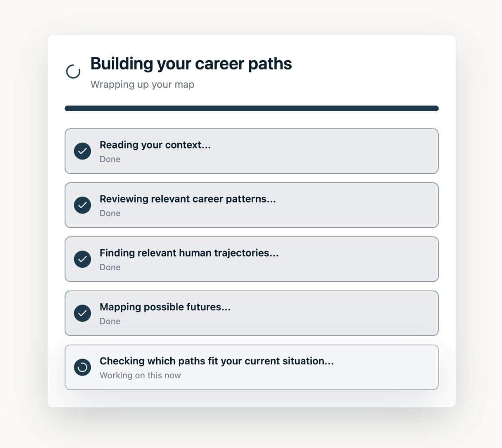
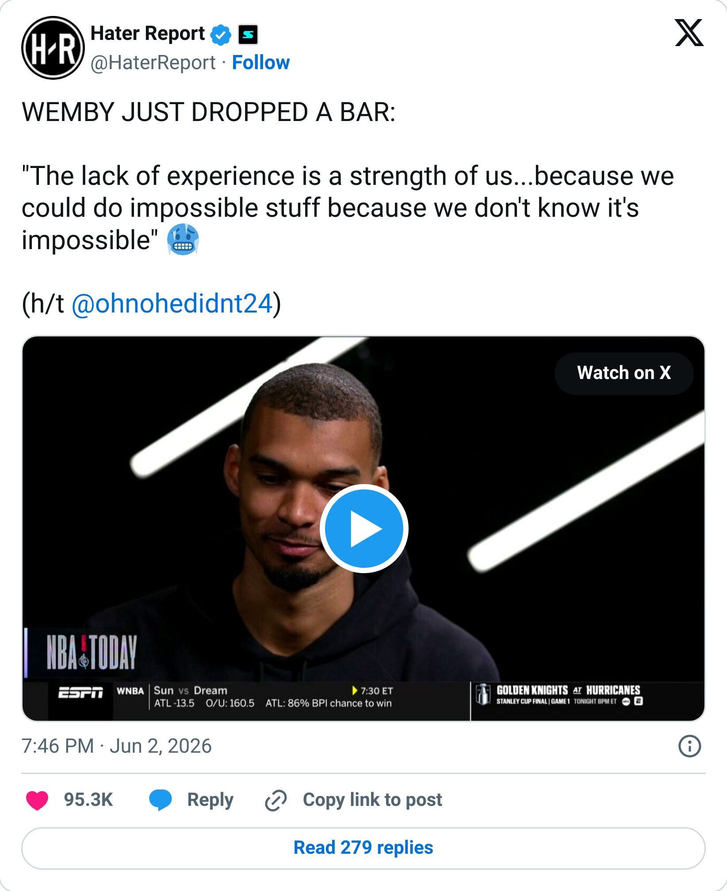
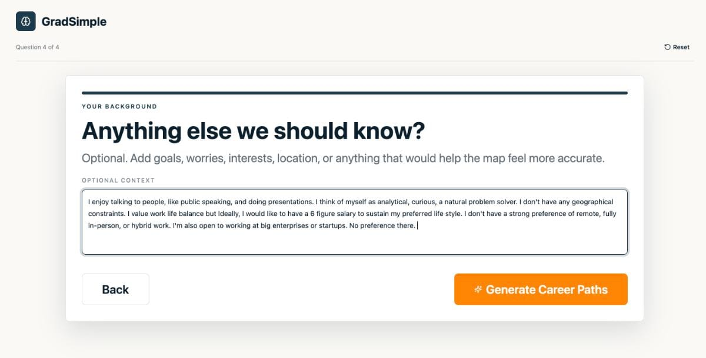
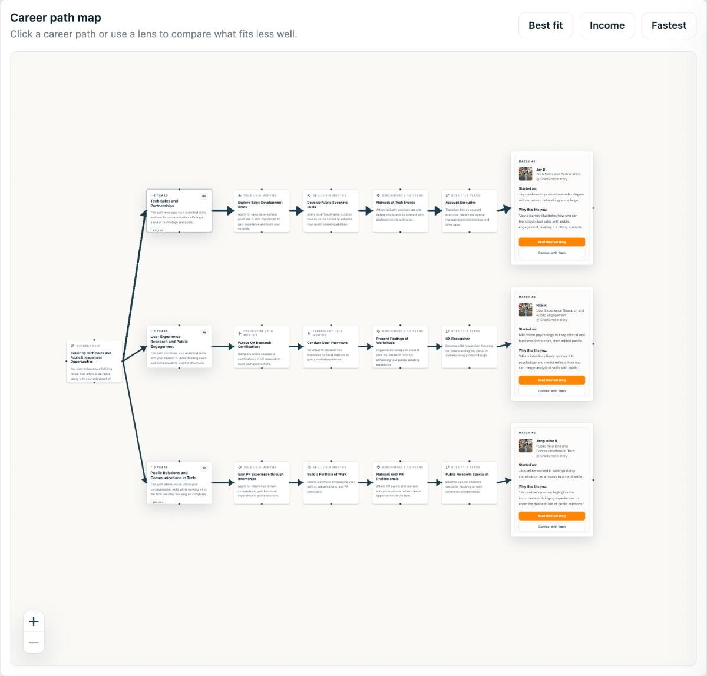
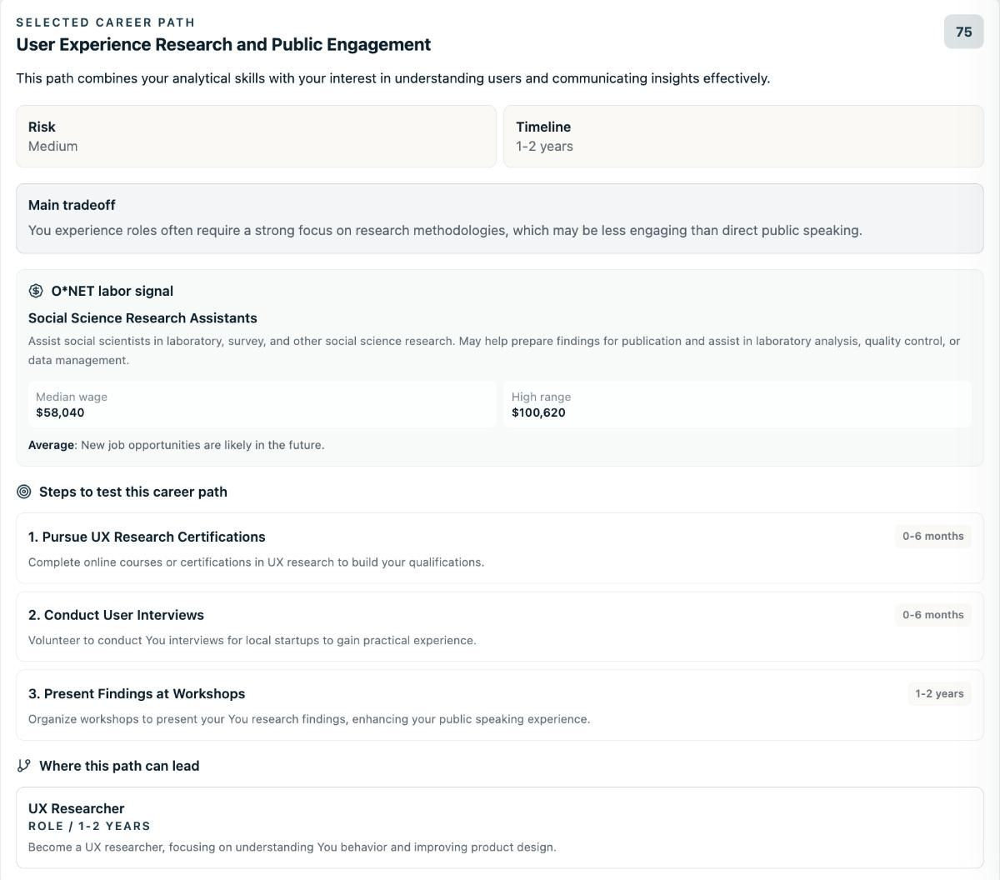
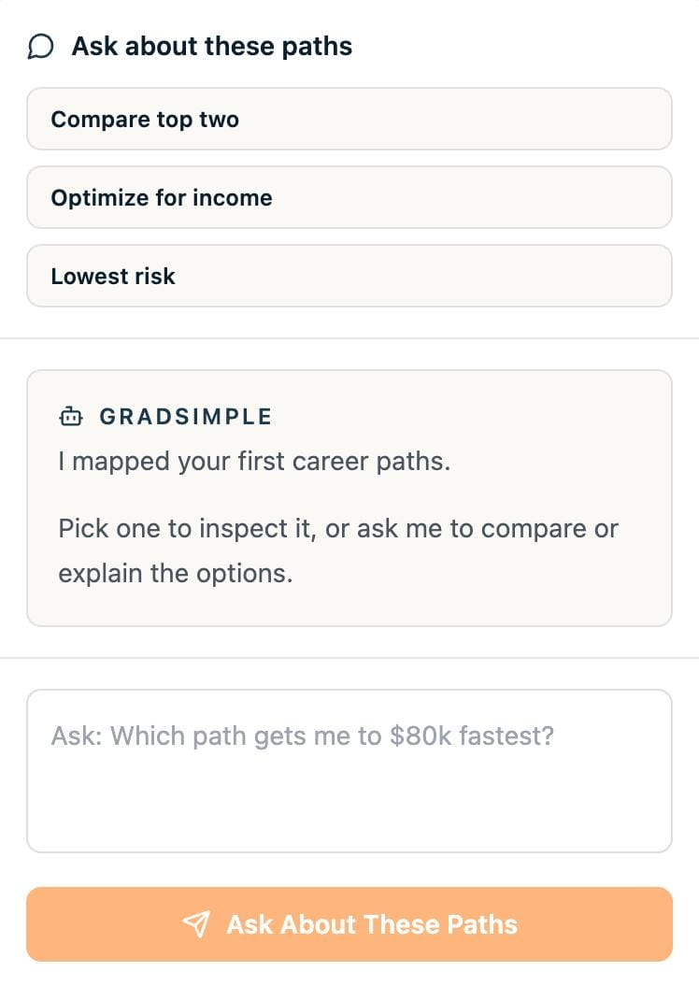
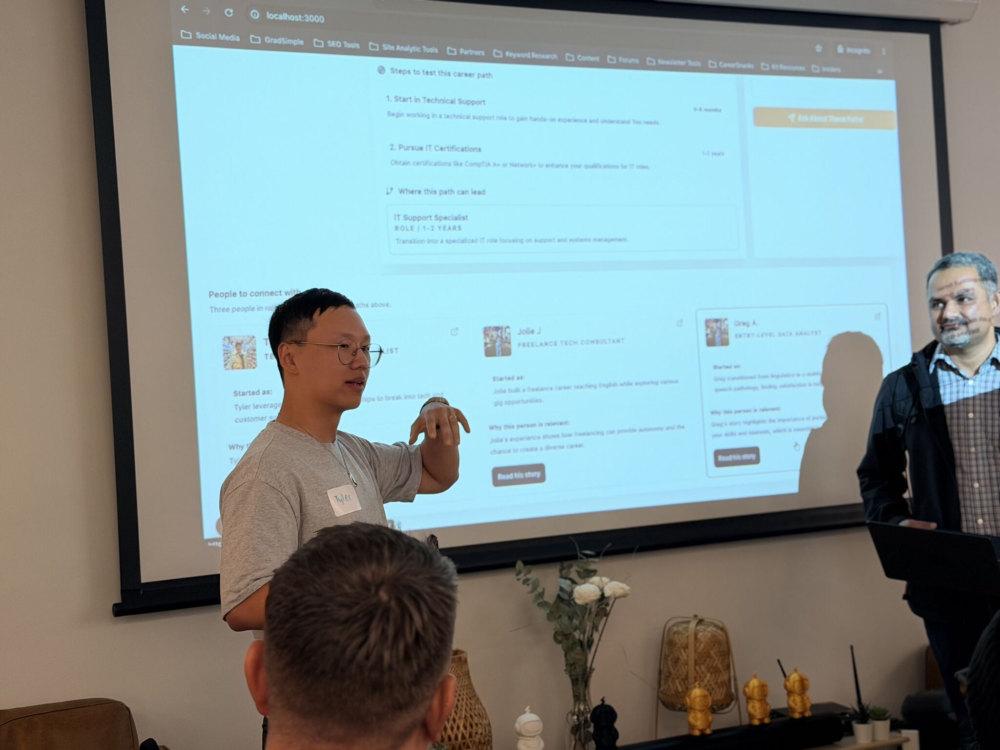

# I did my first AI Hackathon (Part 2)

By Tyler Yip · 2026-06-09

A developer took photos of my prompts to show his son.

Last week I shared [how I ended up at a vibe coding hackathon](i-did-my-first-ai-hackathon-part-1.html) I had no business being at. This is what happened next.

## **We tried… building an app in 6 hours **

My team was Nehal, a staff data engineer. Martin, a dev team lead. And Vicky, a second year network security student.

The theme was second brain. Which lined up almost perfectly with the career path visualizer I came in wanting to build.

We spent the first two hours planning. Mapping the user experience, debating what was useful vs what just sounded cool, and figuring out what we could realistically ship by 4pm.

Watching Martin sketch out the app architecture before touching a single line of code was genuinely fascinating. I had never done that. When I built stuff solo, I would just open Claude and start describing things. Seeing what *real* developers do first made me realize how much I didn’t know.

I guess you could say I really took “vibe” in vibe coding to the extreme.

Oh and I should probably mention. Every app I'd ever vibe coded before this was built with Claude. But I figured a hackathon sponsored by Codex was as good a time as any to figure it out.

## I was the one building in Codex

My screen was projected on the TV. My teammates were advising, flagging issues, helping with backend decisions. But the building was happening through me describing exactly what I wanted to Codex.

At one point I was fixing the loading screen. It would race through the first four checks instantly, hang for almost 20 seconds, then dump everything at once. Bad experience. So I told Codex to slow it down. Give each step a similar amount of time to load.

It was fixed in seconds.

I kept making changes to the UI/UX to get it looking the way I had in mind. At one point Nehal leaned over and said if they had done that manually, it would have taken hours.

Eventually, he started taking pictures of my prompts.

He pulled me aside later and said he wanted a record for inspiration, and to show his son. Because he and his teammates are all so technical, their instinct is to go directly into the code. Watching me describe what I wanted in plain language and get strong results was something he hadn't seen before. He wanted to learn how to work that way.

That moment meant more to me than any award.

Who would have thought my lack of experience in coding would be my greatest advantage. I literally don’t know what’s impossible, so I have the audacity to do the impossible. Reminds me of this quote from Wemby:

> 

## Here's what we built: the GradSimple App

Most career tools assume careers are linear. They hand you a personality quiz result or a generic job list and call it a day. "Try product management." "Go into consulting." Cool, thanks.

But careers are messy. People pivot. They take weird first jobs. They discover constraints they didn't know they had. They change their minds entirely.

The problem isn't that students lack options. It's that they can't see into any of them. Career advice is abstract. A real person's career journey isn't.

So we asked: what if you could “see” into a possible future before committing to it? Not just a generic, static recommendation. A path, tied to a person who actually lived it.

That's what we built.

Here’s how it works. You answer four questions. Your education, current field, experience level, and any extra context you want to throw in. Things like "I love money and can tolerate crazy hours" or "I’m willing to move anywhere in the world" or "I want to do fulfilling work and make a difference to the world."

The app generates a visual map of three career futures, branching out from where you are today. Best fit. Highest income. Fastest route.

Each path pulls salary and job data from the O*NET API.

It shows AI disruption risk, realistic timeline, main tradeoffs, and concrete next steps.

But the part I'm most proud of: every path is matched to a person from GradSimple's database of 100+ industry professionals. You get their background, why they're relevant to your situation, a link to read their full story, and the option to connect with them directly.

So instead of "go into customer success," you get matched with someone who’s gone down that path.

And if you have specific questions, you can just ask.

The goal was never to tell someone what to do. It was to help them see possible futures, understand the tradeoffs, and pick one small thing to try next, rooted in reality. I think we pulled off a solid prototype.

And no, I'm not sharing it publicly (yet?). Between the API costs and the fact that it was built in six hours, it's not quite ready for that. But if there's enough interest, who knows.

## It wasn't all smooth

My Codex credits got assigned to a business workspace account by mistake. The ambassador on site couldn't fix it. All the OpenAI support engineers were offline because it was Sunday. My teammates couldn't redeem their credits either for unrelated reasons. So we were building the whole thing on fumes.

I ended up upgrading my Codex plan to Pro to unblock us.

$100 USD / month. Ouch.

Deadline was 4pm. We submitted at 3:50. I had to record the demo in one take. Thank god for Codex who built our presentation slides and script.

**Then came the pitch.**

Every team got two minutes. We had 0 practice.

Our app required users to fill out a questionnaire which ate up most of that time on its own. We were frantically trying to fill out the inputs.

Thirty seconds in I could tell the judges weren't feeling it. I had to buy time.

So I scrapped the script and just started talking. The problem we were solving. Who it's for. Why it matters. What the app does.

That's when I saw heads start nodding.

Just as I could feel the judges come around, the timer went off. I ran out of time. Sh*t.

My teammates thought it went great. But I honestly felt I butchered it.

Still, I couldn't help but feel proud. We were four strangers who met that morning. We had no shared history, no pre-built team chemistry, no practice run. And we shipped a working app in six hours. That's kind of insane when I think about it.

## We didn't win

In hindsight, our app wasn't optimized around any of the prize categories. Best use of CLōD, lifelong learning, physical commerce. It was first place or bust for us.

But we did get special recognition! We were one of two teams to get a shout out for best UI/UX and product. One of the VC judges from INP Capital mentioned it was neck and neck and that a few teams could have easily taken first. She gave us laptop sleeves as a consolation prize.

I'll take it.

At the end of the event my teammates said they'd definitely be coming to more hackathons and maybe we could form a core team for future events. That made me really happy.

## After the event

I got a DM from one of the judges. Senior DevOps at Epic Games. He said GradSimple was his number one pick out of every app that day and that he was "very impressed."

He didn't have to send that. He did anyway. That meant a lot.

I went in planning to join someone else's team and not be a burden. I ended up leading a build, presenting to a panel of judges, and walking out with new friends.

And now I know I can spar with developers.

Next time, I'm going for first place!

[Read on Tyler’s site](i-did-my-first-ai-hackathon-part-2.html)
