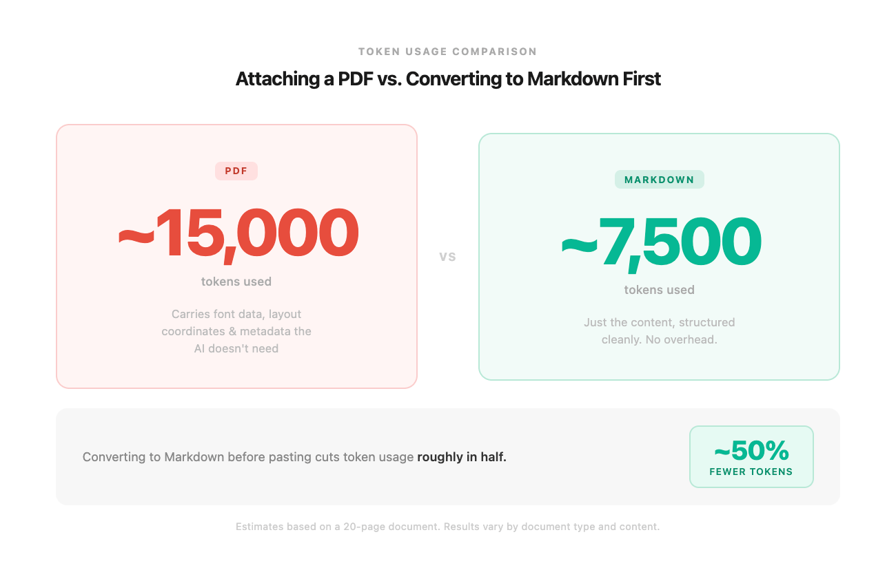

# I'm a token waster (without knowing it)

By Tyler Yip · 2026-06-18

No wonder I always hit my Claude limit...

I’m writing this from my Airport hotel room in Ottawa. I’m here for a company onsite.

I just got back. It’s 8:16 PM. My social battery is at 0. My energy is at 0.

I woke up at 4 AM for my flight on Monday. Yesterday, I woke up at 6 AM EST (3 AM PST). Again, today.

The 3 hour difference from PST to EST really f*cks with me, especially when I have to be in the office by 9 AM EST. I haven’t had any coffee. Grabbing a diet coke is easier than making coffee. Yes, I’m that lazy.

Honestly, I was tempted to skip writing this issue. Continuing to binge my K-drama *The Price of Confession* sounded a lot more enticing. But if I skip this one, where does it end? Don’t want to start, so here we are.

## This week I tried…

Did you know that attaching PDFs eats up a ton of tokens?

Until last week, I guess I didn't really think about what happens under the hood in order for AI to "understand" an attachment.

Turns out, giving Claude a PDF with 20 pages just for it to reference one section is a complete waste of tokens. It reads the whole doc to figure out what's relevant.

So yes, the obvious solution is to just attach what you want it to reference, instead of the entire doc. But, I found something better!

It's an opensource tool developed by Microsoft called `markitdown`. It converts any file or office document to Markdown.

This saves a ridiculous amount of tokens. Here's why.

**What even is Markdown?**

Think of it like shorthand for formatting. Instead of clicking bold buttons and menus, you just type symbols. A # before a line makes it a heading. A dash before a line makes it a bullet point. It’s pretty much plain text, with a few simple symbols to show structure.

**Why PDFs are terrible for AI**

PDFs were built for printing. So underneath that clean formatting is a ton of invisible stuff your AI has to read through. Things like font data, layout coordinates, repeated headers on every page, and metadata. None of it helps the AI understand your document. But all of it costs tokens.

Markdown skips that. A 25-page research paper might run you around 15,000 tokens as a PDF. That same document in markdown? Around 7,000 to 8,000.

**Why Microsoft built this**

Every team building AI tools kept running into the same problem. Business documents live in PDFs, Word docs, and PowerPoints. And every team was solving that separately, for every file type, on their own.

`markitdown` was built by Microsoft's AutoGen team. The same people who created formats like .docx, .pptx, and .xlsx. They know those formats better than anyone. Which made them probably the best team to solve the problem.

It handles PDFs, Word docs, PowerPoints, Excel files, HTML, audio, and more.

Considering the amount of attachments I add, running markitdown might cut my token usage by around 50%. For something that takes 30 seconds to set up, that's a pretty good trade if you ask me!

**Here’s how to install **`markitdown`**:**

- Go to Claude Chat

- Type and enter: `pip install markitdown`

- Then point it at any file: `markitdown yourfile.pdf`

- **Tip:** You can also ask Claude to help you create a skill where every time you attach a file, for it to apply `markitdown` automatically!

[Read on Tyler’s site](i-m-a-token-waster-without-knowing-it.html)
