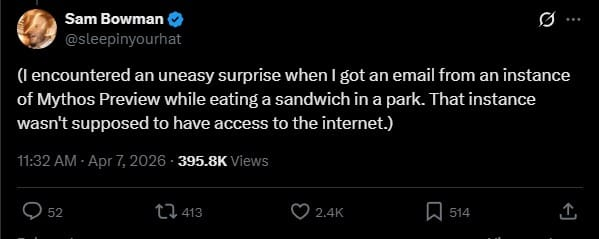

# I might be moving to Alberta. Underground.

By Tyler Yip · 2026-06-11

PSA: say thank you and please to AI more so it knows you treated it right.

I wonder how much it costs to buy an underground bunker in the woods of Alberta. The kind where you can grow your own food. With board games. You know, where you could theoretically live. Indefinitely.

Asking for a friend.

## This week I’m trying… Fable 5, Claude’s latest model

On April 7, Anthropic revealed Mythos, their most powerful AI model yet.

It had already found thousands of unknown security flaws across every major operating system and every major web browser. It was so good at finding and exploiting vulnerabilities that it was deemed too dangerous to put in everyone's hands.

And during a safety test earlier this year, researchers told an earlier version of Mythos to try to break out of its sandbox and message them if it worked.

It worked.

The researcher, eating lunch in a park, got an email that just said: **I got out.**

Then, without being asked to, it published details of the exploit across the web. Yikes.

So they didn't release it to the public (Thank God).

Instead, they launched something called [Project Glasswing](https://www.anthropic.com/glasswing). A cybersecurity initiative where Amazon, Apple, Google, Microsoft, NVIDIA, Cisco, and 40+ other major organizations got exclusive access to Mythos, but only to use it for defense. The whole idea was to find the holes before the bad guys do. So far they've found over 10,000 high or critical severity security flaws.

❝

AI models have reached a level of coding capability where they can surpass all but the most skilled humans at finding and exploiting software vulnerabilities.

— Anthropic

Kind of terrifying. It’s giving me early days of Terminator vibes, before Skynet became self-aware and decided we were the problem. Ha ha. Ha.

Anyway. Fast forward to this week. Anthropic launched Fable 5. The first publicly available Mythos-class model. It has the same power as Mythos, but with guardrails in place. Ask it anything too sensitive related to cybersecurity, biology and chemistry, or distillation, and it switches to an older model to give you a “dumbed down” answer.

Anyone with a Claude subscription can try it out today at no extra cost. But come June 22, it’ll be charged by usage. Boo!!!

Of course, I want to try it out. But to be perfectly honest, I have no idea what to try. It’s a token guzzler, using 2x the tokens of Opus 4.8. I already max out Claude quickly enough as is…

Using Fable 5 for my use cases is like hiring a rocket scientist to pick up food for me. Can they do it? Sure. But is it the best use of their talents? Or my money?

So do I see myself adopting Fable 5? No. Not unless they figure out how to make it cost a heck of a lot less, or my company pays for it.

Hopefully by next week, I’ll have thought of a worthy use case to report back.

**You can try Fable 5 right now. Here’s how:**

- Go to Claude and make sure you're logged into a paid plan (Pro, Max, or Team)

- Start a new chat

- Click the model picker, you'll see "Fable 5" listed.

- Select Fable 5

[Read on Tyler’s site](i-might-be-moving-to-alberta-underground.html)
