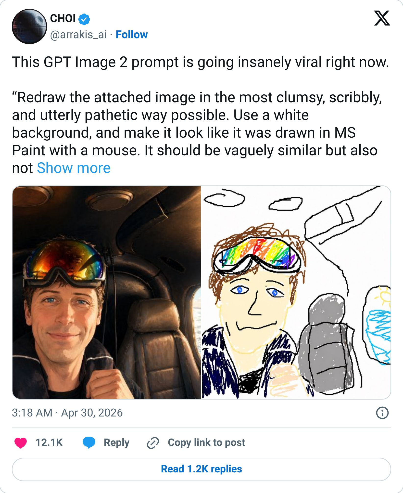
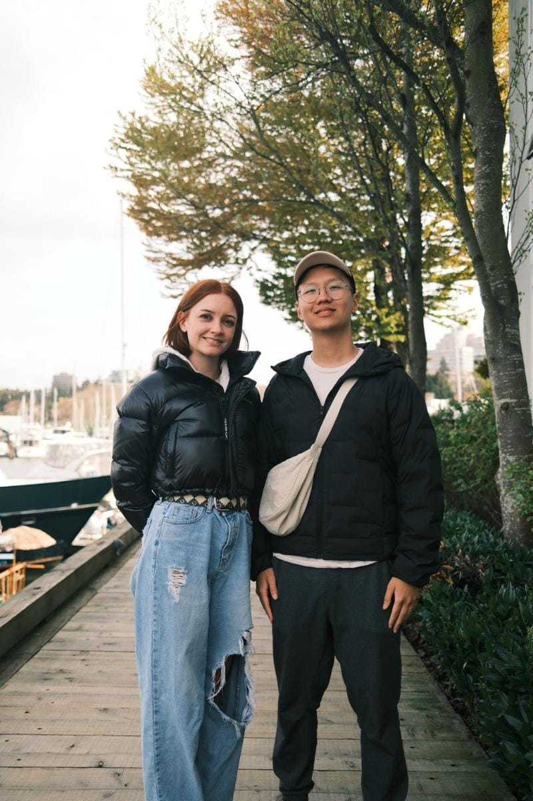
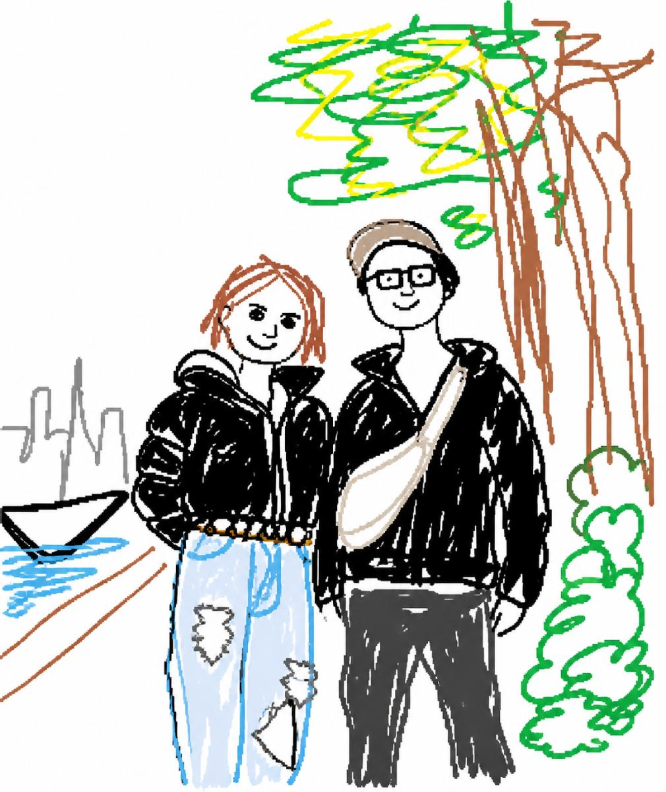
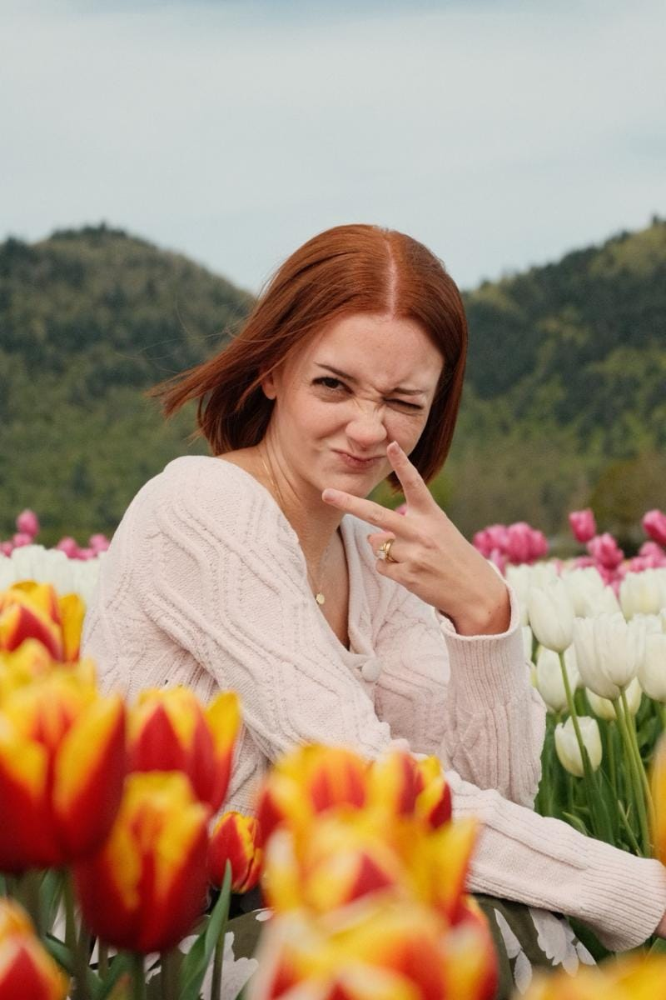
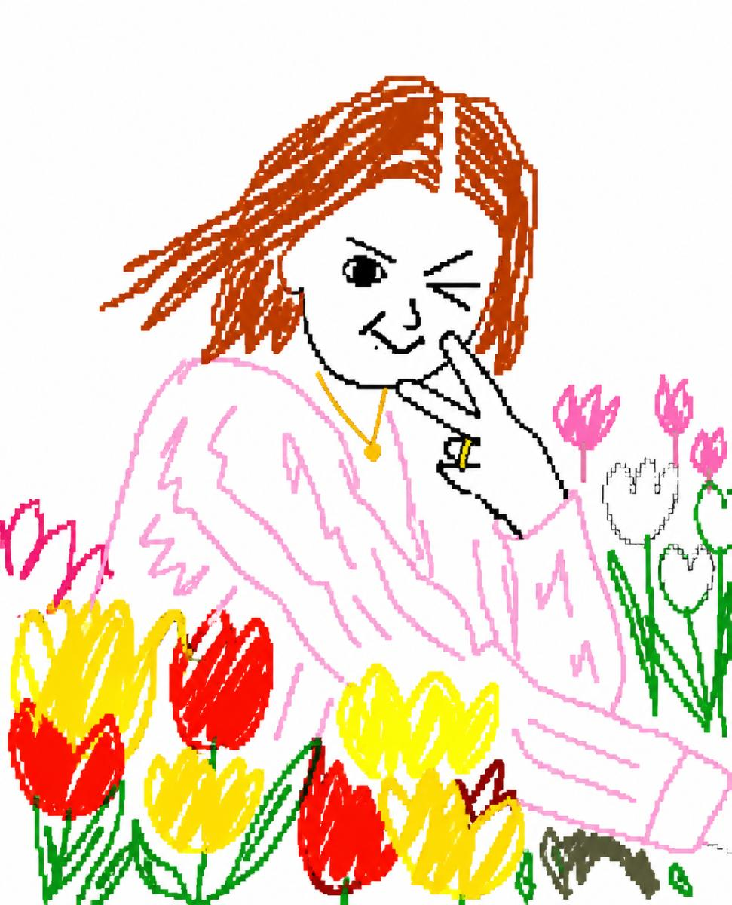

# I turned my wife into an MS Paint drawing

By Tyler Yip · 2026-05-05

This AI prompt is genuinely too fun

Two years ago, AI image generation was so bad you didn't even need the six fingers to give it away. You could just tell. So I stopped using it in early 2024.

But then 2 weeks ago, OpenAI released [GPT Image 2.0](https://openai.com/index/introducing-chatgpt-images-2-0/), their best image generation model yet. And people on X started turning photos of themselves into MS Paint drawings. I had to try it.

## This week I tried… creating an MS Paint version of my wife and I using ChatGPT

My first impression of GPT Image 2.0 is just: wow.

From what I tested, it's *way *better at following specific instructions, rendering text, and creating images that actually look real. It’s not perfect, but noticeably better.

The MS Paint trend on X is the perfect way to see what it can do.

> 

I used the prompt from the tweet and attached a picture of Grace (my wife) and I to see how it would look.

And another of Grace being Grace:

I’m impressed that it even got her ring. If I’m being honest, I don’t even think I can draw that badly, that well.

I'm planning to start using ChatGPT a lot more for visuals for my GradSimple blog posts. I'll keep you posted on how that goes.

**Now go try the prompt yourself: **

- `Redraw the attached image in the most clumsy, scribbly, and utterly pathetic way possible. Use a white background, and make it look like it was drawn in MS Paint with a mouse. It should be vaguely similar but also not really, kind of matching but also off in a confusing, awkward way, with that low-quality pixel-by-pixel feel that really emphasizes how ridiculously bad it is. Actually, you know what, whatever, just draw it however you want.`

[Read on Tyler’s site](i-turned-my-wife-into-an-ms-paint-drawing.html)
