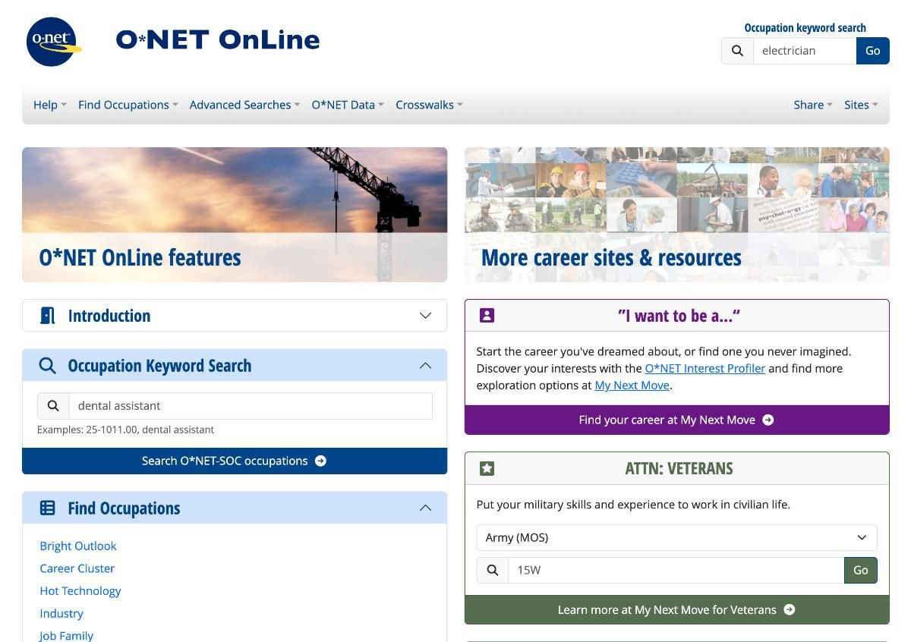
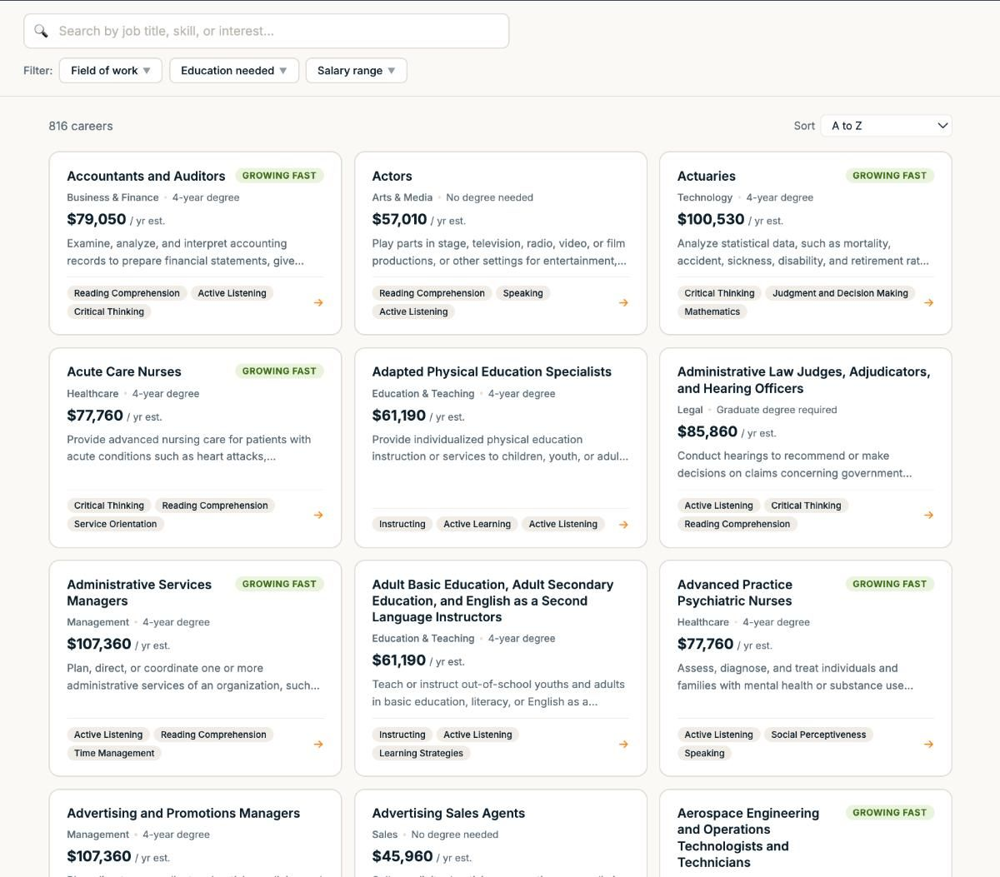

# Rebuilding a website from the 90s

By Tyler Yip · 2026-05-27

With 0 coding knowledge. Thanks Claude.

Sometimes, I *really *wish I could code. Just imagine all the wonderful websites and apps I can build. Like what if I built a compass app that points me to the closest bubble tea store based on my live location?

Anyway, Claude exists now so I can do whatever I want.

## This week I tried… building a career explorer app with Claude

The [O*NET](https://www.onetonline.org/) interface is what I imagine websites looked like in the 90s. And no, I don’t mean that in a cute, nostalgic way.

If you don’t know what O*NET is, it’s a free database by the US government with information on hundreds of jobs. It’s primarily used as a career exploration tool. Allegedly last updated on April 14, 2026. You be the judge of that.

So I decided to take a stab at creating a better UI/UX version for GradSimple members.

For this app, I went with Claude because I love its collabrative approach to building. And by collaborative, I mean it holds my hand and walks me through everything.

I started by explaining what I had in mind:

I want to create a new tool for GradSimple. I'm thinking of creating a better UI/UX O*Net tool. I presume that data is open source right? 

Turns out the O*NET database is licensed under Creative Commons 4.0, meaning it's free to use as long as you credit the US Department of Labor. Good to know!

I then created a web developer account on O*NET Web Services, got a free API key, and had Claude spoon-feed me instructions like I was 5. I had no idea what I was doing. And it didn't matter!

After some back and forth on design and troubleshooting bugs, I deployed the app on Vercel and embedded it into GradSimple. Total build time: about 2 hours.

[Click here to check it out!](https://gradsimple.com/career-explorer/)

For something I built on a whim in 2 hours, I think it turned out really well. It's incredible how easy it is for anyone to build apps now!

Go check it out here and let me know what you think!

**Now go build something. Here’s how:**

- Think of a tool or app you wish existed

- Open Claude and describe your idea

- Ask Claude to help you stress test your idea, think through how it should work, and what it should look like

- Ask Claude to give you step by step instructions to build it

- Follow the steps, and when something breaks, share a snippet of the error back into Claude and keep going

- Repeat until it works. That's literally it.

[Read on Tyler’s site](rebuilding-a-website-from-the-90s.html)
