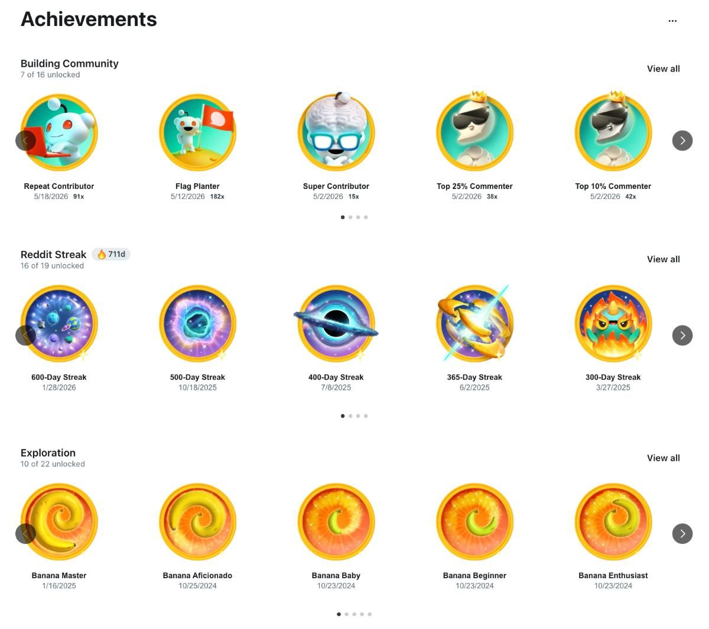

# Reddit, arthritis, and AI

By Tyler Yip · 2026-05-21

What could they possibly have in common? I'll tell you.

I wrote this email 30,000 feet in the air. I also tried running a Codex automation on Air Canada’s free wifi. Note to self: it doesn’t work.

## This week I tried… the Chrome plugin on Codex to help me find Reddit posts and comment on them

For 711 days in a row, I've spent at least half an hour on Reddit. And no, I don’t use it for pleasure.

I use Reddit solely for guerilla marketing.

I find posts from people I think would love GradSimple and I comment on them. I average 30 comments a day. I hate doing it, but I can't deny the results. More than half of all GradSimple subscribers came from me commenting on Reddit.

When I first started, it took 2 to 3 hours. After iterating with AI, I got it down to half an hour. But I'm still manually scrolling to find posts, using ChatGPT or Gemini to help draft responses, then reviewing, editing, and posting each one myself. Start to finish, each comment takes about a minute. Times 30. Every single day.

The cost of all this repetitive clicking is probably early onset arthritis. My fingers creak and ache like a 60-year-old man's. I'm not even kidding.

So I tried to automate it. I really, really tried.

OpenAI agent mode: finicky as heck, hit my token limit within 2 hours. ChatGPT Atlus: also finicky, couldn't reliably find posts, couldn't figure out how to scroll Reddit without tweaking out, and is apparently blocked from seeing Reddit posts in the browser anyway. The Reddit API: building a bot for my use case violates their developer policies. I wasn't risking my account.

At that point I got scrappy. I built a tool with Claude that scraped r/careerguidance, matched posts to keywords like "college" and "degree," and opened everything relevant in one click. It worked until Reddit's rate limits decided it didn't. I even built a Chrome Extension just to copy a post's title and body into ChatGPT faster. One less click per comment. 30 comments a day. Every day. Yes, I'm that desperate.

I was stuck.

Then two weeks ago I saw a post on X showing OpenAI's new Chrome plugin for Codex. My brain started turning. Could this thing browse Reddit, find posts, and draft comments?

I installed it and started prompting.

*"@chrome open Reddit and find me 30 posts under r/careerguidance by people asking for help about making a career decision."*

Holy sh*t. It worked. First try.

I asked it to open all 30 posts in new tabs. It did.

Then I asked for the thing I actually wanted. Draft a response for each post. One paragraph of real advice. One paragraph softly plugging GradSimple. Just drop it into the comment box and let me review before I post.

I was so hesitant asking. Up to this point, nothing had worked.

It said yes. And it freaking did it.

I sat there staring at my screen. 30 tabs. 30 drafted comments. Just sitting there waiting for me to review them. Two years of aching fingers and failed experiments, and this thing just did it on the first try.

My fingers shed a tear. I'm so happy I could name my firstborn Codex.

**Now go try it yourself. Here’s how:**

- Download the Codex app from OpenAI's website and install it

- Go to plugins and install the **Chrome plugin**

- Open a new chat and tag Chrome in your prompt so it knows to use the browser. Something like: `@chrome open [any website] and find me [whatever you're looking for]`

- Once it finds what you need, ask it to take the next step. Open tabs, draft responses, fill in fields. Just keep prompting like you're talking to a person.

[Read on Tyler’s site](reddit-arthritis-and-ai.html)
