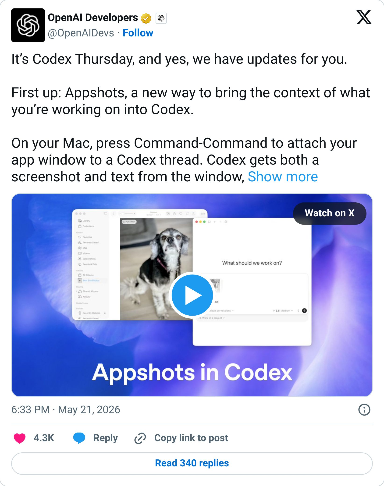
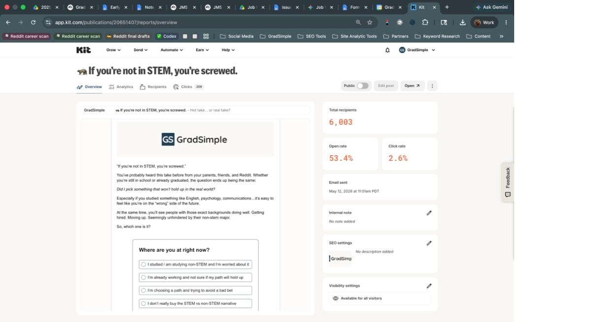

# This is like screenshot on steroids

By Tyler Yip · 2026-05-22

For AI.

OpenAI has been dropping so many bangers lately, this newsletter is starting to sound like I’m sponsored. I promise, I still love Claude and use it every day.

## Fresh Drop Friday: Codex Appshots

I find myself screenshotting stuff all the time, then having to find the file and copy and paste it into the prompt box of ChatGPT or Claude. It gets annoying.

Yesterday, OpenAI dropped a cool feature in Codex called Appshots that I will be using *a lot*.

> 

Now when you press `cmd + cmd` on any app window, Codex will screenshot it, jump to Codex, find your most recent thread, and automatically attach it for you.

Now I know what you're thinking, because I thought this too. *So this is just screenshotting?*

Yes, but on steroids. It also captures the readable text and UI structure from the app you are capturing. What does this even mean?

You know how sometimes the content in the window you want to share is too long, so you have to take multiple screenshots? With Appshots, you don’t need to do that anymore. It can “see” things in your window that aren’t visible in the screenshot.

Here's an example. This is a normal screenshot I took of a GradSimple newsletter on my Mac.

From the image alone, you can only see the top of the email. The title, the intro paragraph, a poll, and the dashboard stats on the right. If you sent just that screenshot to ChatGPT, it cannot see anything below that. But with Appshots, Codex can see everything in that window, all the way down to the footer.

Yeah, I know, that was my holy s*ht moment too. Yet another reason to try out Codex if you haven’t!

**Now go try it yourself. Here’s how:**

- Open Codex and open up a chat

- Go to an app window you want to screenshot

- Press `cmd + cmd` at the same time. *One finger on the ⌘ key left of the space bar and one finger on the ⌘ key right of the space bar

- Codex will automatically screenshot the window and attach it to your chat.

[Read on Tyler’s site](this-is-like-screenshot-on-steroids.html)
