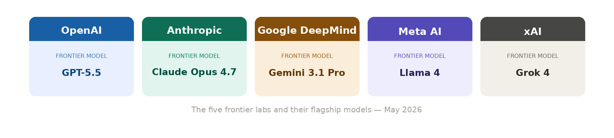

# Wtf is... a "frontier lab" (learn in 1 min)

By Tyler Yip · 2026-05-25

I'd lick anyone's boots to work at one. Even throw in a foot massage.

Grace and I were strolling along the water by English Bay, sipping our maple earl grey matcha lattes from a local cafe called Superbolt Lab Matcha Tea. It's officially my crack drink.

Like any normal pair, we were discussing whether working at somewhere like OpenAI or Anthropic is worth it. We agreed that the hours, the pressure, and the money is probably like working in investment banking.

I said I'd kill to work at any frontier lab. Drop everything, work 996, move countries even. She stopped and asked what I meant by "frontier lab." And that's when I realized I'd been throwing the term around like everyone already knows what it means.

Naturally, I decided to write about it for this week’s lunch & learn Monday!

## WTF is… a frontier model & a frontier lab?

The word frontier literally means the boundary between what's known and what's unknown. In AI, a frontier model is exactly that. The most capable AI that exists right now.

The most intuitive example I can think of is the phone industry. There's the big guns like Apple, Samsung, and Google. Each of them have their own flagship model, the iPhone, Galaxy, and Pixel. Every year they release something new that becomes the most advanced version available. And less than a year later the bar moves again. Frontier models work the same way, except at 10 times the speed.

So who builds them?

There are thousands of AI tools out there, but only a handful of companies are building the thing powering all of them. Those are the frontier labs, and it's a pretty short list. OpenAI, Anthropic, Google DeepMind, Meta AI, and xAI. Just five companies, for now at least. Chinese labs like DeepSeek are starting to close the gap fast so who knows what things will look like in another year.

Every AI tool you use, every chatbot, every AI feature inside your work software, is almost certainly built on top of what one of these five labs created. You've probably used one of their current flagships. GPT-5.5 from OpenAI. Claude Opus 4.7 from Anthropic. Gemini 3.1 Pro from Google. Llama 4 from Meta. Grok 4 from xAI.

The time between new frontier model releases has dropped from around 170 days in 2023 to under 50 days today. Isn't that crazy?

[Read on Tyler’s site](wtf-is-a-frontier-lab-learn-in-1-min.html)
