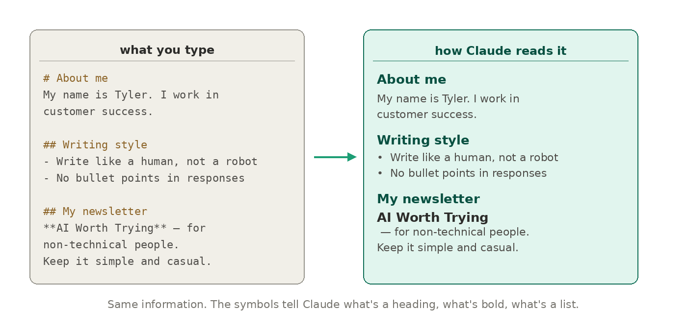

# Wtf is... a ".md" file? (learn in 2 mins)

By Tyler Yip · 2026-05-18

Markdown this, markdown that. Wtf is markdown??

I procrastinated. I’m frantically writing this from the Montreal airport, less than an hour before boarding my flight to Vancouver.

## WTF is… a .md file?

Every time you start a new Claude conversation, it knows nothing about you. A .md file fixes that.

.md stands for Markdown. It's a plain text file with a set of simple symbol rules baked in. A hashtag before a word means heading. Two asterisks around a word means bold. A dash at the start of a line means bullet point. The symbols do the same job as clicking buttons in a Word doc, except there are no buttons, just text.

A regular .txt file has none of those rules. If you type a hashtag, it's just a hashtag. Nothing more. The files look identical if you open both of them. The difference only shows up when something like Claude reads it and knows to apply the Markdown rules.

*So why does Claude care?*

Because structure helps. When you give Claude a .md file instead of a wall of copy-pasted text, it understands what's a heading, what's a list, what's a key detail. Better structure in means better answers out. Think of it like handing someone a clean organized brief versus reading them a block of random notes out loud.

That's why using .md files has become best practice when working with Claude specifically.

**Here's how it works in practice. **Inside Claude, you can create something called a Project. A Project is a dedicated workspace where Claude remembers context across conversations. Inside those Projects, you can store a .md file with your instructions, preferences, and context. Things like how you like responses formatted, what your job is, what you're working on. Claude reads that file every single conversation automatically. You never have to re-explain yourself.

That's the real power of a .md file. It's how you teach Claude who you are and how you work, once, so you never have to repeat yourself again.

You don't need to be technical to make one. Open any basic text editor on your computer, write your content using those simple symbols, and save it as** ****[filename.md](http://filename.md)**** **instead of **filename.txt**. That's it! You just made a Markdown file.

[Read on Tyler’s site](wtf-is-a-md-file-learn-in-2-mins.html)
