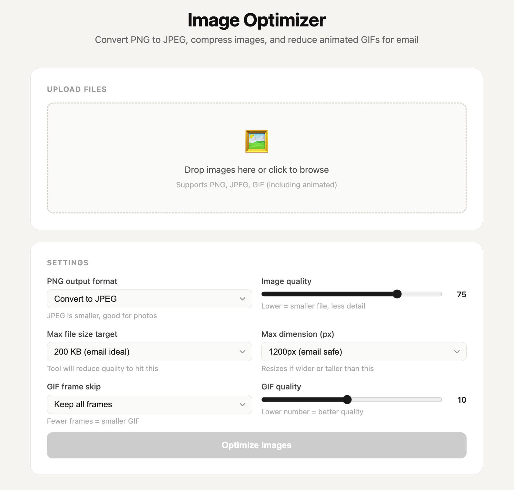

# Wtf is... an "artifact" (learn in 1 min)

By Tyler Yip · 2026-06-02

Maybe it's time for me to call it quits...

Sup champ,

I can't believe it's already been 1 month since I started this newsletter.

I can now confidently say: sending 3 issues a week is too much for me, lol.

I kind of suspected that would be the case, which was why I haven't publicized this project to anyone. I wanted to see if I could sustain writing this on top of having a full-time 9-to-5 job, my 5-to-9 in GradSimple, and life.

I can't!

So. Back to Tuesday and Thursday it is. I'd rather consistently deliver 2 a week than fail to write 3 when I'm strapped for time.

## WTF is… an artifact?

You've probably asked Claude to build something and noticed that instead of just responding in the chat, something pops up on the right side of your screen. A working app, a chart, a tracker, a game. Live, interactive, ready to use. That's what an artifact is.

An artifact is anything Claude builds for you that goes beyond a regular text response. Something you can actually see and interact with. Claude writes all the code behind it automatically and you never have to touch it or even know it exists.

And just so you know, "artifact" is a Claude specific term. You won't really hear it used anywhere else. It's just what Anthropic decided to call it.

So what can you build with one? More than you'd expect honestly. Interactive apps, calculators, dashboards, habit trackers, games, resumes, reports, data visualizations.

I’ve used it to build a ton of stuff like: a job market tracker, a career assessment, an image compressor, a TikTok to MP4 converter, and even a Reddit scraper.

I was tired of using ad-filled websites to compress images so I [built my own web app](https://gradsimple-image-optimizer.netlify.app/).

A year ago, I would have needed a developer for all the things on that list. Now it takes me like 20 minutes.

The process is pretty straightforward. You literally just tell Claude what you want.

Something like "build me a nutrition tracker" or "make me a calculator that figures out my mortgage payments" or "create a quiz based on this document." Claude builds it, the artifact shows up on the right side of your screen, and you can click around and test it immediately. If something isn't right you just tell Claude to fix it in the same conversation.

And when you're happy with it, you can publish it and share it as a link. The person on the other end doesn't even need a Claude account to open it. If you’re curious, I’ll talk about exactly how in a future issue. Trust me, it’s super easy.

[Read on Tyler’s site](wtf-is-an-artifact-learn-in-1-min.html)
