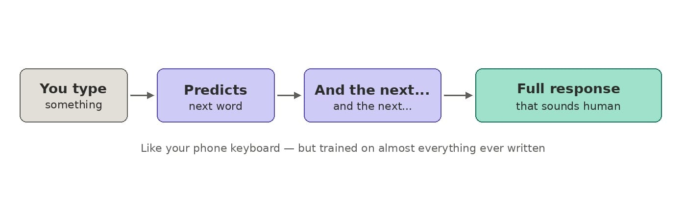

# Wtf is... an "LLM" (learn in 2 mins)

By Tyler Yip · 2026-05-11

Yes, I *know* what it means. But also not really.

I want to dumb down commonly used AI terms for myself. Things like LLM, tokens, context window. You know, words us non-technical people hear or even use on a daily basis but don't really know what any of it means. And I call myself an "AI Champion."

Maybe I'll call it lunch and learn Mondays? LLM.

## WTF is… an “LLM”

LLM gets thrown around like everyone knows what it means. They probably don’t. At least I didn’t.

**An LLM, or Large Language Model, is the engine behind most AI tools you've probably already used.** ChatGPT, Claude, Gemini -- they're all built on LLMs. When you type something and get a surprisingly smart response back, that's an LLM doing the work.

So what's a "language model?" Think of it this way. You know how your phone keyboard suggests the next word when you're texting? An LLM does that same thing, except it was trained on an almost unimaginable amount of text -- books, articles, websites, forums, code, you name it -- and it does the prediction thing billions of times over to generate a full response.

When you do that at a large enough scale, something weird happens. The model starts to "understand" context, tone, nuance, and meaning. Not the way humans do, but well enough to hold a conversation, write a report, explain a concept, or help you draft an email.

I know what you’re thinking. If it's just predicting words, why does it seem so... aware? Why does it give such eerily thoughtful answers? Why do some people worry it might be conscious?

Honestly, because it's really, really good at the prediction part. So good that the outputs *feel like* understanding. *Feel like* reasoning. *Feel like *personality. But there's actually no awareness behind it. At least not today. It doesn't “know” it exists. It's pattern matching at a scale that's hard for our brains to wrap around, and our brains instinctively read that as intelligence.

The fear mostly comes from not knowing where the ceiling is. If it got this good this fast, what does another five years look like? That's a fair question. But right now, it's a *very *powerful autocomplete.

[Read on Tyler’s site](wtf-is-an-llm-learn-in-2-mins.html)
