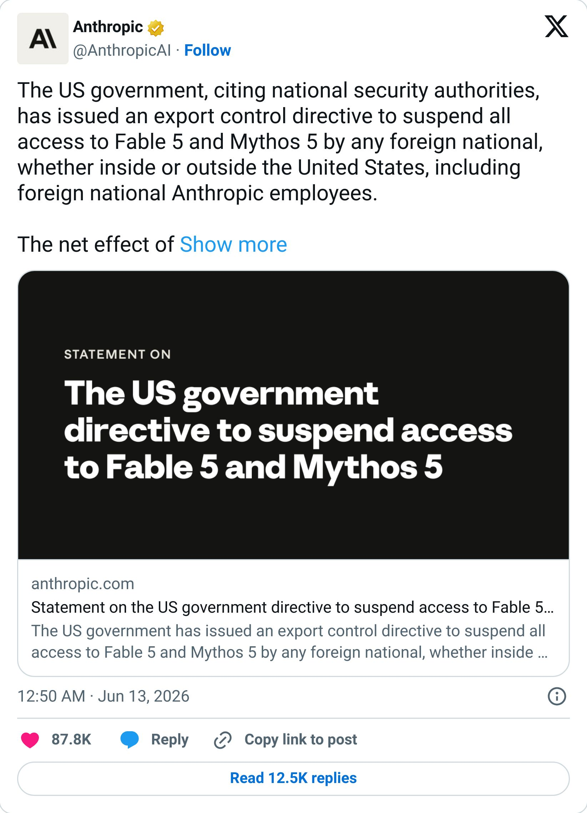

# WTF is... Skills vs Connectors vs Plugins?

By Tyler Yip · 2026-06-16

Ngl, it took me an embarrassingly long time to tell the difference.

Sup champ,

I'm not surprised that the US government shut down Fable 5. What did Anthropic expect?

They spent months hyping up how dangerous Mythos was. They said it could find and chain together software vulnerabilities that no human researcher could catch. They built an entire initiative called Project Glasswing specifically because they knew what it was capable of. They were essentially humble bragging about how scary their own model was.

> 

Honestly, the US government's response makes complete sense. If even half of what Anthropic said about Mythos is true, shutting it down is the rational move. You can't spend months telling the world your model is uniquely dangerous and then act surprised when someone takes you seriously.

Oh and apparently it was Amazon CEO Andy Jassy who flagged the concerns to the government in the first place. Make of that what you will.

Classic fk around and find out.

## WTF is... Skills vs Connectors vs Plugins?

You've probably clicked around the Claude Directory at some point. Maybe you even connected Gmail or Google Drive. But if someone asked you to explain the difference between Skills, Connectors, and Plugins right now, could you?

It took me an embarrassingly long time to know the difference. Here's the simplest way to think about it: Connectors give Claude access. Skills give Claude instructions. Plugins give Claude a job.

**Connectors** are like giving Claude a key to your other tools. By default Claude has no idea what's in your Gmail, your Google Drive, your Slack, or your Canva workspace. A Connector changes that. It lets Claude walk into those tools and work inside them on your behalf. The Canva Connector for example lets Claude create designs, apply your brand kit, resize assets, and search your existing library without you leaving the chat.

**Skills** are saved instructions that Claude reads before responding. You could have a Skill that tells Claude to always write in a casual tone without bullet points. Or one that tells Claude exactly how your company reviews contracts. Or one that explains who you are and what you do so you never have to repeat yourself. Claude reads it automatically and just knows.

**Plugins** are like downloading an app on your phone. You just install it and it works. Each Plugin comes pre-loaded with Connectors, Skills, and commands bundled together for a specific job. A marketing Plugin might already have the Canva Connector set up, Skills for writing on-brand copy, and a /draft-post command ready to go. One install and the whole workflow is ready.

[Read on Tyler’s site](wtf-is-skills-vs-connectors-vs-plugins.html)
