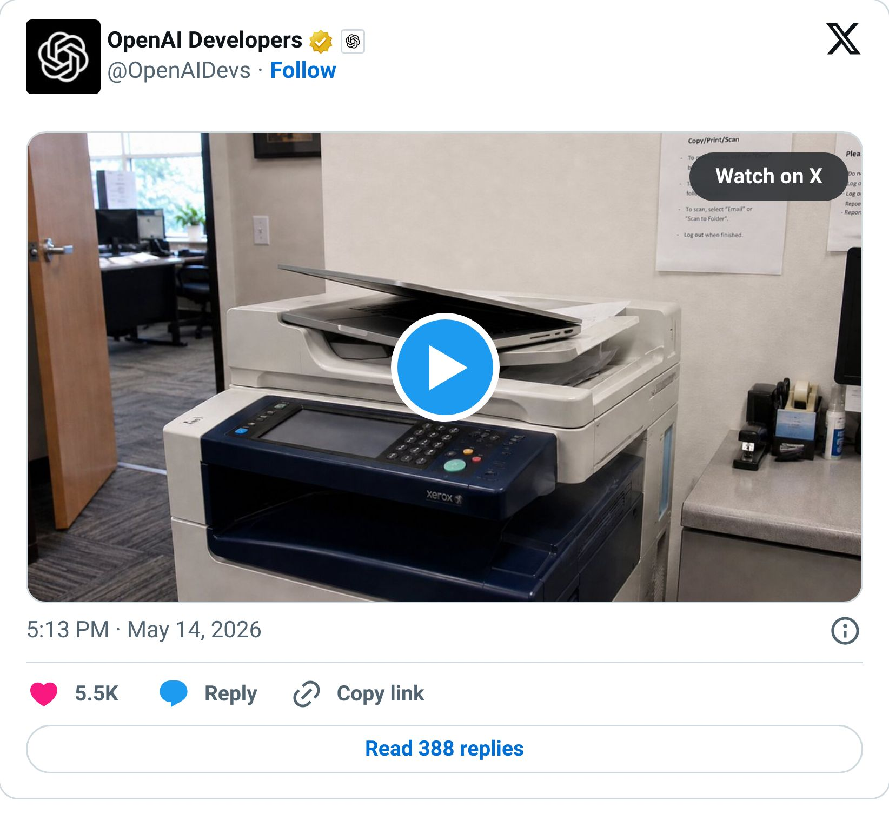
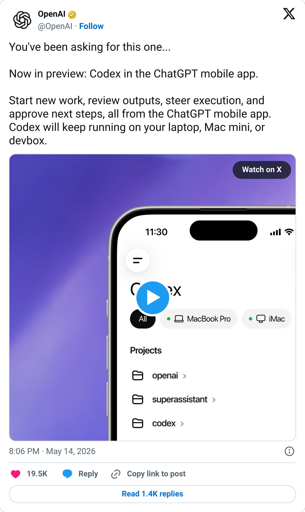

# You can now babysit AI from anywhere

By Tyler Yip · 2026-05-15

The beach. Your couch. Oh, and today is a historic day. Our very first Fresh Drop Friday!

I’ve been debating whether to make this newsletter every Tuesday and Thursday, or every Monday, Wednesday, and Friday. I’m leaning towards the latter.

Monday can be called Lunch & Learn Mondays (LLM). Wednesdays? Perhaps Use Case Wednesdays? Friday can be Feature Fridays. Or how about Fresh Drop Fridays? I kind of like the ring of it.

## Fresh Drop Friday: Codex Mobile

Codex has been one of the most hyped AI tools on for months. And honestly, the hype is deserved. But every time I'd see someone showing off what it could do, there was always one thing holding me back from fully buying in.

It was desktop only. *Ew. *

OpenAI knew it too. They literally dropped a meme about it right before the announcement.

> 

Well. They fixed it!

Codex is now available in preview inside the ChatGPT mobile app. I like to think of it as a command centre for your phone. You kick off a big task on your computer, step away, and check in from your phone whenever Codex needs a decision. Change direction, approve next steps, stay in the loop. You can literally go to the beach and still be in the loop. Now this is* true *remote work, lol.

Not a coder? Me neither. But this is the whole promise of AI agents finally showing up in real life. AI works in the background, you live your life, you check in when needed. That's kind of a big deal.

From what I'm seeing in the comments, you'll need to update both the mobile and Codex apps to get access. Early bugs to be expected since this literally just dropped.

I'm playing with this over the weekend. Will report back!

> 

[Read on Tyler’s site](you-can-now-babysit-ai-from-anywhere.html)
